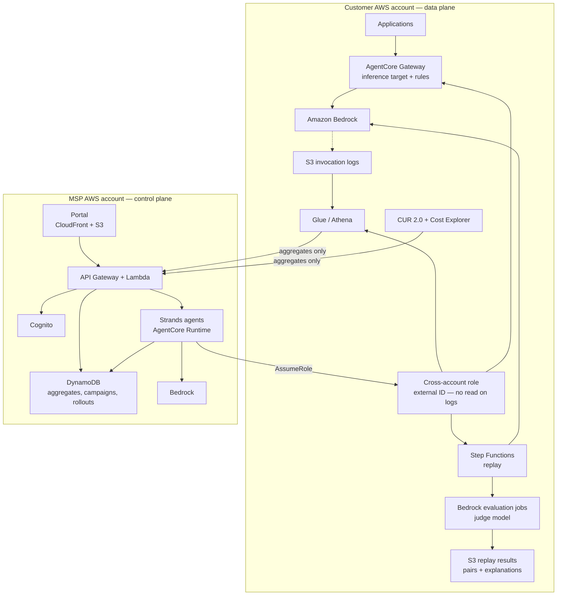

# Jauge — FinOps for generative AI on Amazon Bedrock

**Attribute** every inference dollar to an application, a team and a request type.
**Prove** that a cheaper model does the job, by replaying the customer's own
requests against candidate models and judging the answers. **Apply** the change
through a gateway rule in stages, then verify the saving on the invoice.

Jauge is a managed service sold by an AWS MSP: a subscription plus a share of
verified savings. It is built for the **AWS MSP AI Hackathon** — Track 2,
*Deliver AI-Driven Outcomes for Customers*.

> **Live portal:** https://baptistefaisy.github.io/jauge/ — the demo portal, published on GitHub Pages
> from this repository. It runs on a recorded snapshot of the real API (no
> backend), so approvals and rollouts are simulated in your browser; every figure
> shown was computed by the code, never by a language model.
>
> The normative specification and the internal working notes are in French under
> `docs/fr/`. Every submission deliverable — this README, the High-Level Design,
> the architecture document, the portal — is in English.

---

## The problem

A company runs generative AI in production on Amazon Bedrock. Its inference bill
grows every month and it cannot answer three questions:

1. **Which application and which team produce the spend?** The "Amazon Bedrock"
   line of the invoice says nothing about who consumes it.
2. **Would a cheaper model do the same job — with evidence?** The team picked the
   most capable model during the prototype and never revisited it. Nobody dares
   to change it, because nobody can measure what the change would cost in
   quality.
3. **Did the change actually reduce the bill, at constant volume?** Cost
   reductions are usually declared, not verified.

The levers that would cut the bill — a smaller model, prompt caching, a cheaper
service tier, batch processing — stay unused because proving they are safe takes
time the product team does not have.

## The value proposition: proof by replay

Saying *"this model is cheaper"* convinces nobody. Jauge replaces the opinion
with a measurement:

1. **Draw a reproducible sample** of the customer's real requests — 200 by
   default, stratified, seeded, sensitive requests excluded.
2. **Replay** them inside the customer's own AWS account, on the current model
   (twice, to measure its own variability) and on each candidate, at the same
   parameters.
3. **Judge** each pair with an LLM judge, and check the deterministic
   constraints of the task — valid JSON, schema, label, length.
4. **Decide** with a rule, not a feeling: equivalence rate above the
   application's threshold, the *lower bound* of the 95 % confidence interval
   above 90 %, and no critical deterministic failure.
5. **Switch** traffic with an AgentCore Gateway rule — 10 %, 50 %, 100 % — with
   automatic rollback if online quality drops. The application's code and model
   id never change.
6. **Verify** the saving 30 days later, at constant volume, against the tagged
   invoice line.

A campaign that finds no acceptable model ends with *"keep your model"*, with the
evidence. That is a result too.

---

## Architecture in one diagram



**Privacy by construction.** Request and response text never leaves the customer
account: the MSP cross-account role has no read permission on the log or replay
result buckets. It can start the replay state machine and read aggregate tables —
nothing else. In code, the only type that carries text is
`PaireRejoueeDataPlane`, documented as data-plane-only; every control-plane type
carries numbers and identifiers only.

Full diagram: [`docs/architecture.svg`](docs/architecture.svg) ·
[`docs/architecture.mmd`](docs/architecture.mmd) ·
design rationale: [`docs/ARCHITECTURE.md`](docs/ARCHITECTURE.md).

---

## What is in this repository today

Status on `main`, stated plainly: **every module of the build plan is merged** —
M1 to M18 of [`docs/MODULES.md`](docs/MODULES.md), including the wiring of the
agent and API ports onto the real modules (M17) and the pre-submission finishes
(M18). What is left is not code but gestures: a real AWS deployment, the video
shoot, and the Devpost submission (see [`docs/SUBMISSION.md`](docs/SUBMISSION.md)).

| Area | Status |
|---|---|
| Shared entities: tenants, applications, pricing, daily cost, levers, campaigns, recommendations, rollouts | **Delivered** — `src/jauge/models/` |
| Typed error hierarchy, id/seed/fingerprint helpers | **Delivered** — `src/jauge/common/` |
| Request cost from a dated price table (input, output, cache write, cache read; Standard-tier fallback) | **Delivered** — `src/jauge/engine/calculator.py` |
| Daily aggregation per application/team/model, bill reconciliation with gap and unattributed share | **Delivered** — `src/jauge/engine/attribution.py` |
| Wilson confidence interval, percentiles, minimum sample size, monthly saving, percentage drop | **Delivered** — `src/jauge/engine/stats.py` |
| Store contract (tenant-scoped) + in-memory implementation | **Delivered** — `src/jauge/store/` |
| Log ingestion, tagging, unattributed spend, CUR 2.0 reconciliation (M1) | **Delivered** — `src/jauge/attribution/` |
| Dated price-table loader with validation, demo price file (M2) | **Delivered** — `src/jauge/pricing_data/`, `data/pricing/` |
| Savings-lever detection: 4 model rules + 3 service rules, ranked by estimated saving (M3) | **Delivered** — `src/jauge/levers/` |
| Stratified reproducible sample, replay executor (Flex tier), campaign cost cap, Step Functions definition (M4) | **Delivered** — `src/jauge/replay/` |
| LLM-as-a-judge prompt and adapters, deterministic checks, decision rule with its three conditions, human review sub-sample (M5) | **Delivered** — `src/jauge/evaluation/` |
| Gateway rules, staged rollout 10/50/100, automatic rollback, savings verification (M6) | **Delivered** — `src/jauge/rollout/` |
| Strands agents: orchestrator + four specialists used as tools, guardrails, schemas, traces, sessions (M7) | **Delivered** — `src/jauge/agents/` |
| Control-plane REST API: authentication, roles, tenant isolation, audit, settings (M8) | **Delivered** — `src/jauge/api/` |
| Monthly report: computed figures + written synthesis, Markdown/JSON, S3 adapter (M9) | **Delivered** — `src/jauge/reports/` |
| CDK control plane (M10) + single per-customer CloudFormation template (M11) | **Delivered** — `infra/control-plane/`, `infra/client-account/` |
| Synthetic-traffic demo and offline seed (M12), static no-build portal (M13) | **Delivered** — `demo/`, `portal/` |
| End-to-end acceptance R1–R13, including negative security tests (M15) | **Delivered** — `tests/recette/` |
| Real adapters wiring the agent and API ports onto the modules (M17), seeded ASGI entry point, `/health` probe, rollout driven through the API (M18) | **Delivered** — `src/jauge/integration/`, `jauge.api.app:app` |

The whole test suite runs offline — no AWS account, no network, no credentials.
The real boto3/Bedrock adapters are written but exercised only through their
interface with fake clients, so the suite never reaches AWS. On `main` today
`uv run pytest` reports **1078 passed** (the duration depends on the machine).

### Results: measured vs target

No result is claimed that the repository does not produce. The figures below are
**targets** from the specification, not measurements:

| Indicator | Target | Status |
|---|---|---|
| Inference bill reduction at equal quality, on a treated application | 20–40 % (production assumption, to be validated) | **Target** — measured during the demo, published after the recording |
| Attribution coverage on demo accounts | 100 % | **Target** |
| Reconciliation gap between recalculated and invoiced cost | < 3 % | **Target** |
| Time from onboarding to the first quantified recommendation | < 1 day | **Target** |

Every number Jauge displays is computed by code from logs and the invoice; no
language model computes one (`ENF-IA-01`).

---

## Quickstart

```bash
# 1. Install (Python 3.12+, uv: https://docs.astral.sh/uv/)
uv sync --all-groups

# 2. Run the test suite — offline, no AWS account, no credentials
uv run pytest
#   ...                                              [100%]
#   1078 passed in 2:43    (count on `main` at the time of writing)

# 3. Run the same gates as CI
bash scripts/ci-local.sh
```

### Run the offline demo

```bash
uv run python -m demo.seed     # seeds an in-memory store, prints the summary
```

`demo.seed` generates the §18.1 scenario — three applications at customer A, one
at customer B — and prints the figures the code computed. These are **demo
output, not a customer result**: a mean reconciliation gap of **0.57 %** (14/14
days inside the 3 % target), an estimated **628.58 $/month** of savings across
eight detected levers, a `ticket-classifier` recommendation pending approval, a
`support-assistant` campaign rejected with evidence, and a `doc-summarizer`
rollout at stage 50 % with online quality 0.995.

### See it in the portal

Two ways to open it:

| Mode | Where | Data | Writes |
|---|---|---|---|
| **Public, static** | https://baptistefaisy.github.io/jauge/ (GitHub Pages, published by `.github/workflows/pages.yml`) | Snapshot `portal/data/demo.json`, recorded from the real API by `scripts/export_portail_statique.py` | Simulated in the browser (decision, staged rollout, rollback); lost on reload |
| **Local, live** | `uv run uvicorn jauge.api.app:app` | The seeded in-memory store, through the real modules | Real: the API writes to the store and the audit log |

Both serve the same portal code. In static mode `portal/js/statique.js` answers
instead of the network — with the **same** JSON shapes, the same tenant
isolation (403 `tenant_isolation_violation`) and the same refusal to roll out
without approval (409 `approval_required`). The header says which mode is live.

The static portal (`portal/`, no build step) is served by the control-plane API.
One command starts everything — the ASGI entry point `jauge.api.app:app` seeds
the demo scenario and wires the API ports (campaigns, reports, chat, **staged
rollout**) onto the real modules:

```bash
uv run uvicorn jauge.api.app:app --reload   # then open http://127.0.0.1:8000
```

The seeding runs on first access to `app` (a few seconds), not at import time, so
tests that only import `creer_app` do not pay for it. With
`JAUGE_MODE_DEMO=0` the same entry point serves an **empty**, Cognito-protected
application: no seeding, and the un-wired ports answer `502` explicitly.

In demo mode the API trusts two headers instead of Cognito: `X-Jauge-Tenant`
(`t-demo-a` / `t-demo-b`) and `X-Jauge-Role`. Demo mode is refused when
`JAUGE_ENV=production`. Full judge instructions, demo accounts and a
minute-by-minute test path: [`docs/TEST-INSTRUCTIONS.md`](docs/TEST-INSTRUCTIONS.md).

---

## Repository layout

| Path | Content | Status |
|---|---|---|
| `src/jauge/models/` | Pydantic entities — the shared vocabulary of every module | Delivered |
| `src/jauge/common/` | Error hierarchy, identifiers, seeds, fingerprints | Delivered |
| `src/jauge/engine/` | Deterministic computation: request cost, aggregation, reconciliation, statistics | Delivered |
| `src/jauge/store/` | Persistence contract + in-memory implementation | Delivered |
| `src/jauge/attribution/` | Invocation-log ingestion, tagging, unattributed spend | Delivered (M1) |
| `src/jauge/levers/` | Savings-lever detection rules | Delivered (M3) |
| `src/jauge/replay/` | Stratified reproducible sampling, replay execution, Step Functions definition | Delivered (M4) |
| `src/jauge/evaluation/` | LLM-as-a-judge scoring, deterministic checks, decision rule, human review | Delivered (M5) |
| `src/jauge/rollout/` | Gateway rules, staged rollout, automatic rollback, savings verification | Delivered (M6) |
| `src/jauge/agents/` | Strands agents: orchestrator + cost analyst + replay planner + results reader + writer | Delivered (M7) |
| `src/jauge/pricing_data/` + `data/pricing/` | Dated price table loader, validation, demo price file | Delivered (M2) |
| `src/jauge/api/` | Control-plane REST API (FastAPI) | Delivered (M8) |
| `src/jauge/reports/` | Monthly report generation | Delivered (M9) |
| `src/jauge/integration/` | Real adapters wiring the agent and API ports onto the modules | Delivered (M17) |
| `infra/control-plane/` | AWS CDK app for the MSP account | Delivered (M10) |
| `infra/client-account/` | Single CloudFormation template deployed per customer | Delivered (M11) |
| `demo/` | Synthetic traffic generator and demo applications | Delivered (M12) |
| `portal/` | Static web portal, no build step | Delivered (M13) |
| `docs/` | HLD, architecture, demo script, submission checklist, test instructions | Delivered |
| `tests/` | Unit and isolation (negative security) tests, end-to-end acceptance | Delivered — 1078 passed on `main`, offline |

Work breakdown, module ownership and per-module "definition of done":
[`docs/MODULES.md`](docs/MODULES.md).

---

## Documentation

| Document | For |
|---|---|
| [`docs/HLD.md`](docs/HLD.md) | **High-Level Design** — context, scope, two planes, components, data model, campaign flow, attribution and reconciliation, quality method, rollout, security, observability, decisions and trade-offs, limits, glossary |
| [`docs/ARCHITECTURE.md`](docs/ARCHITECTURE.md) | Component-by-component architecture, the gateway rule, data flows, API surface, deployment topology |
| [`docs/architecture.mmd`](docs/architecture.mmd) / [`architecture.svg`](docs/architecture.svg) | The diagram, as source and as image |
| [`docs/DEMO-SCRIPT.md`](docs/DEMO-SCRIPT.md) | The 3-minute video, timed, with the shooting checklist |
| [`docs/SUBMISSION.md`](docs/SUBMISSION.md) | Submission checklist and the answer to the four judging criteria |
| [`docs/TEST-INSTRUCTIONS.md`](docs/TEST-INSTRUCTIONS.md) | How to run it, demo accounts, guided test path |
| [`docs/deploy-client.md`](docs/deploy-client.md) | Installing the data plane in a customer AWS account — one CloudFormation template, one command |
| [`docs/fr/cahier-des-charges-finops-ia.md`](docs/fr/cahier-des-charges-finops-ia.md) | Normative specification (French) — requirement ids `EF-*`, `ENF-*`, `R*` |

---

## Development and CI

Every pull request runs four jobs, each capped at **5 minutes**:

| Job | What it checks |
|---|---|
| `lint` | `ruff check` + `ruff format --check` |
| `limits` | Files < 500 lines, functions < 50 lines |
| `test` | `pytest` (unit, isolation, acceptance), offline |
| `iac` | `cfn-lint` on CloudFormation templates + CDK assertion tests |

Plus the repository baseline: `ci-budget` (no job may declare a timeout above
5 minutes), `stale-base-guard`, and the `hermes-lite` freshness gate. Merges go
through a merge queue that requires all four jobs to be green (Mergify
configuration in the repository); direct pushes to `main` are blocked by branch
protection.

```bash
bash scripts/ci-local.sh      # the whole CI, locally
```

House rules: no file above 500 lines, no function above 50 lines, one
implementation per piece of logic, no network in tests, and no number computed by
a language model.

---

## Security and privacy

- **Cross-account access** through a least-privilege role with an external ID,
  created by the customer's own CloudFormation template.
- **Request text stays in the customer account**: no read permission on the log
  and replay-result buckets.
- **Tenant isolation** enforced in code — every store and API read takes
  `tenant_id` first — and verified by negative tests (customer B on customer A's
  data → refusal).
- **Encryption** at rest (KMS, customer-managed keys for logs) and in transit.
- **No traffic change without human approval**; automatic rollback when online
  quality falls below the alert threshold.
- **Replayed request content is data, never an instruction** for Jauge's agents.
- **Campaign spend** estimated before launch and capped per tenant.

---

## Deploying

The infrastructure is delivered as code and verified offline (CDK assertion tests
for the control plane, `cfn-lint` for the customer template). **No real AWS
deployment has been run yet** — it needs AWS accounts, credits and Bedrock model
access enabled, and it is the main remaining gesture before submission. The steps
are:

1. **Customer account** — deploy `infra/client-account/template.yaml`: cross-account
   role with external ID and no log-read access, KMS-encrypted log bucket,
   Glue/Athena tables, replay state machine, aggregate push, budget alarm. Then
   enable Bedrock model invocation logging, activate cost-allocation tags and
   connect the CUR 2.0 export.
2. **MSP account** — `cdk deploy` from `infra/control-plane/`: API, Cognito,
   DynamoDB, portal on CloudFront, agents on AgentCore Runtime, budget alarm.

One customer = one template. Another MSP can install the whole solution by
following this README (`ENF-REP-01`).

---

## License

Proprietary — all rights reserved.
