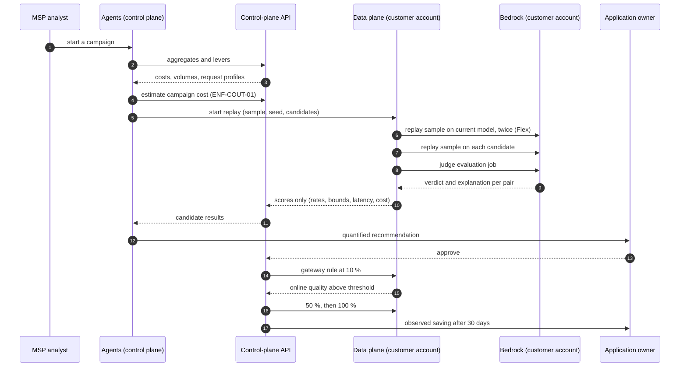

# Jauge — Architecture

**Companion to:** [`HLD.md`](HLD.md) (design rationale, decisions, trade-offs)
**Sources:** [`architecture.mmd`](architecture.mmd) (Mermaid source) ·
[`architecture.svg`](architecture.svg) (rendered, for the submission)
**Requirement identifiers** (`EF-*`, `ENF-*`, `R*`) refer to
`docs/fr/cahier-des-charges-finops-ia.md`.

---

## 1. One picture



If the SVG does not render in your viewer, open
[`architecture.mmd`](architecture.mmd) in any Mermaid renderer, or read the
textual version in section 3.

---

## 2. The two planes

Jauge is split in two by a hard boundary, not by a deployment preference.

| | Data plane | Control plane |
|---|---|---|
| **AWS account** | The customer's | The MSP's |
| **Holds** | Invocation logs, request and response text, replay execution, judge evaluation, replayed pairs and their explanations, replay results | Aggregates, scores, campaigns, recommendations, rollout state, reports, portal |
| **Never holds** | Anything belonging to another customer | Request text, response text, judge explanations |
| **Scaling unit** | One per customer account | One for the whole fleet |
| **Failure impact** | One customer loses analysis | The whole fleet loses its UI and agents |

**The boundary** (`ENF-CONF-01`): request and response text never leaves the
customer account. Two structural guarantees enforce it:

1. The MSP cross-account role has **no read permission** on the log bucket and
   the replay-results bucket. It can start the replay state machine, query
   Athena aggregate tables, read cost data, and create gateway rules. Nothing
   else.
2. In code, the only entity that carries text is `PaireRejoueeDataPlane`
   (`src/jauge/models/campaign.py`), documented as data-plane-only. Every
   control-plane type (`ResultatCandidat`, `Recommandation`,
   `AgregatQuotidien`, `Levier`, `BasculeProgressive`) carries numbers and
   identifiers only. An agent tool or API response that returned a replayed pair
   would have to import a type whose docstring forbids it.

### 2.1 What crosses the boundary, and in which direction

| Direction | Payload | Mechanism |
|---|---|---|
| Control → data | Start a replay (sample size, seed, candidates, judge model) | `states:StartExecution` on the customer's state machine |
| Control → data | Create / remove a gateway rule (traffic weight) | `bedrock-agentcore:CreateGatewayRule` |
| Data → control | Daily aggregates, reconciliation rows, candidate scores, savings verification | Aggregate push Lambda calling the control-plane API |
| Data → control | Audit events (campaign started, rule created, rollback fired) | Same push path, append-only audit table |

No pull. The control plane never reads the customer's S3.

---

## 3. Components

### 3.1 Customer account (data plane)

| Component | AWS service | Responsibility | Code / template |
|---|---|---|---|
| Applications | Customer's own code | Call Bedrock through the gateway | Not Jauge's |
| Inference gateway | AgentCore Gateway (inference target + routing rules) | Single entry point; rule-based model substitution and weighted split | Rule creation from `src/jauge/rollout/` *(planned)* |
| Models | Amazon Bedrock | Inference, Standard / Flex tiers | — |
| Invocation logs | Bedrock model invocation logging → S3 (KMS) | Request, response, tokens, request metadata, tier | Template `infra/client-account/` *(planned, M11)* |
| Analytics | Glue Data Catalog + Athena | Tables over logs and CUR 2.0 | Same template |
| Replay machine | Step Functions + Lambda | Draw sample, replay, launch evaluation, store results | `src/jauge/replay/statemachine/` *(planned, M4)* |
| Evaluation | Bedrock model-evaluation jobs | Judge verdict + explanation per pair | `src/jauge/evaluation/` *(planned, M5)* |
| Replay results | S3 (KMS) | Pairs, explanations, per-request measurements | Same |
| Invoiced cost | CUR 2.0 + Cost Explorer | Dollars per tag, reconciliation source | Same |
| Cross-account role | IAM role with external ID | Least privilege, no read on log/result buckets | Same template |
| Aggregate push | Lambda | Send aggregates and scores to the control plane | Same |

### 3.2 MSP account (control plane)

| Component | AWS service | Responsibility | Code |
|---|---|---|---|
| Portal | CloudFront + S3 (static SPA, no build step) | Customer dashboard, fleet dashboard, approval, rollout tracking, human review link | `portal/` *(planned, M13)* |
| Identity | Cognito | Users, roles (`EF-POR-01`), demo account for judges (`EF-POR-02`) | `src/jauge/api/auth.py` *(planned, M8)* |
| API | API Gateway + Lambda running the FastAPI app | Every endpoint of specification §15 | `src/jauge/api/` *(planned, M8)* |
| Agents | Strands agents on AgentCore Runtime | Orchestrator + cost analyst + replay planner + results reader + writer | `src/jauge/agents/` *(planned, M7)* |
| Agent tools | AgentCore Gateway + Lambda | `query_cost_aggregates`, `list_levers`, `estimate_campaign_cost`, `start_replay`, `get_replay_results`, `save_recommendation` | `src/jauge/agents/ports.py` *(planned, M7)* |
| State | DynamoDB | Tenants, applications, aggregates, reconciliation, levers, campaigns, recommendations, rollouts, verifications, audit | `src/jauge/store/` — protocol + memory **delivered**, DynamoDB adapter *(planned)* |
| Reports | S3 | Monthly report (Markdown + JSON) | `src/jauge/reports/` *(planned, M9)* |
| Infrastructure | AWS CDK (Python) | API, Cognito, DynamoDB, CloudFront/S3, AgentCore, Budgets | `infra/control-plane/` *(planned, M10)* |

### 3.3 Shared library (this repository, delivered)

| Path | Content | Status |
|---|---|---|
| `src/jauge/models/` | Pydantic entities: tenant, pricing, cost, lever, campaign, recommendation | **Delivered** |
| `src/jauge/common/` | `JaugeError` hierarchy, id / seed / fingerprint helpers | **Delivered** |
| `src/jauge/engine/calculator.py` | Request cost (Annexe D), dated price table with Standard fallback | **Delivered** |
| `src/jauge/engine/attribution.py` | Daily aggregation, bill reconciliation | **Delivered** |
| `src/jauge/engine/stats.py` | Wilson interval, percentiles, minimum sample size, monthly saving, percentage drop | **Delivered** |
| `src/jauge/store/protocol.py` | `Store` contract — every read takes `tenant_id` first | **Delivered** |
| `src/jauge/store/memory.py` | `MemoryStore`, tenant-isolated, for tests and the local demo | **Delivered** |

The shared library is what every module codes against. Modules never import
each other's internals; where a module needs a service that does not exist yet it
declares a local protocol (`ports.py`) and a fixture set, and the real wiring
happens in the end-to-end acceptance module (M15).

---

## 4. Request path: the gateway rule

The switch from one model to another is the only action that touches production
traffic, and it is the reason the gateway is in the picture.

```
application ──(model id: <current>)──▶ AgentCore Gateway
                                          │
                             matchModels: anyOf [<current>]
                                          │
                        ┌─────────────────┴─────────────────┐
                        │ routeToTarget (weighted)          │
                        │   weight 10 ──▶ <candidate>       │
                        │   weight 90 ──▶ <current>         │
                        └───────────────────────────────────┘
                                          │
                                          ▼
                                    Amazon Bedrock
```

1. The application keeps its code and the model id it already uses.
2. A rule at priority 100 matches that model id and routes to a target.
3. During rollout the route is **weighted**: 10 %, then 50 %, then 100 % of the
   traffic goes to the candidate (`Recommandation.rolloutPlan`).
4. Rollback = remove the rule. Seconds, no deployment, no code change.
5. A fallback chain keeps the application served if the candidate target fails.

`BasculeProgressive` records the rule id, the current stage, the measured online
quality and the alert threshold. Below the threshold, the rule is removed
automatically (`EF-BAS-03`).

**Fallback for applications outside the gateway** (`EF-BAS-04`): attribution,
lever detection and replay still work; only automatic rollout is unavailable, and
Jauge opens a ticket describing the model-id change.

---

## 5. Data flow: from a call to a dollar

```
model call
   │
   ├─▶ invocation log (S3)  ──▶  Glue / Athena table
   │                                   │
   │                                   ▼
   │                          cost = Σ tokens × dated price
   │                                   │
   │                                   ▼
   │                          daily aggregate (app, team, model, day)
   │                                   │
   │                                   ▼
   └─▶ CUR 2.0 (tagged dollars) ──▶ reconciliation: recalculated vs invoiced
                                              │
                                              ▼
                                   aggregate push → control plane
                                              │
                                              ▼
                                   portal dashboard / agents / report
```

Cost per request (Annexe D), computed by `engine/calculator.calculer_cout_requete`:

```
cost = input_tokens      × input_price(model, region, tier)
     + output_tokens     × output_price(model, region, tier)
     + cache_write_tokens × cache_write_price(model, region)
     + cache_read_tokens  × cache_read_price(model, region)
```

Prices come from a **dated** table (`TarifModele.date_effet`). A price change adds
a row; past costs are never recomputed. `TableTarifs.trouver` picks the most
recent row at or before the requested date and falls back to the Standard tier
when a Flex/Priority row is missing — a missing tier never silently yields zero
cost.

---

## 6. Data flow: a replay campaign



The full method (sample, judge, deterministic checks, decision rule,
self-agreement column) is in [`HLD.md` §8](HLD.md#8-quality-measurement-method).

---

## 7. Control-plane API

Every endpoint of specification §15 is served by the FastAPI application in
`src/jauge/api/` *(planned, M8)*. Grouping by concern:

| Group | Endpoints | Requirement |
|---|---|---|
| Tenants | `POST /v1/tenants`, `GET /v1/tenants/{id}` | `EF-POR-01` |
| Applications | `POST /v1/tenants/{id}/applications`, `GET /v1/applications/{id}` | — |
| Cost | `GET /v1/applications/{id}/costs`, `GET /v1/tenants/{id}/reconciliation` | `EF-RAP-01` |
| Levers | `GET /v1/applications/{id}/levers` | `EF-LEV-06` |
| Campaigns | `POST /v1/applications/{id}/campaigns`, `GET /v1/campaigns/{id}`, `GET /v1/campaigns/{id}/results` | `EF-REJ-01`, `EF-EVA-03` |
| Recommendations | `GET /v1/applications/{id}/recommendations`, `POST /v1/recommendations/{id}/decision` | `EF-REC-01`, `EF-REC-02` |
| Rollout | `POST /v1/recommendations/{id}/rollout`, `POST /v1/rollouts/{id}/rollback` | `EF-BAS-01` … `EF-BAS-03` |
| Savings | `GET /v1/tenants/{id}/savings` | `EF-VER-01` |
| Reports | `POST /v1/tenants/{id}/reports`, `GET /v1/reports/{id}` | `EF-RAP-03` |
| Chat | `POST /v1/chat` | `EF-RAP-04` |

Isolation rule (`ENF-SEC-02`): every read resolves the tenant from the
authenticated principal and passes it as the first argument to the store. A
customer of tenant A asking for tenant B's resource gets a refusal
(`CloisonnementError`), covered by a negative test per endpoint (`R11`).

---

## 8. Agents

```
Orchestrator (Strands)
├── Cost analyst      query_cost_aggregates · list_levers · reconcile_with_bill
├── Replay planner    get_task_profile · list_candidate_models · estimate_campaign_cost · start_replay
├── Results reader    get_replay_results · get_failure_clusters
└── Writer            get_recommendation_inputs · save_recommendation
```

- Agents **choose what to test, interpret results, explain and write**. They do
  not compute a cost, a rate or an interval; they do not read request text; they
  do not approve; they do not roll out (`ENF-IA-01`, `ENF-IA-02`).
- Every tool returns aggregates and identifiers only.
- Structured outputs are validated against a schema before being stored.
- A human-validation interruption precedes the recording of a rollout
  recommendation.
- Rollout is a deterministic API action triggered by the application owner's
  approval, never an agent action.

---

## 9. Security architecture

| Layer | Control |
|---|---|
| Cross-account | Least-privilege role, **external ID**, created by the customer's own CloudFormation template (`ENF-SEC-01`) |
| Confidentiality | No read permission on log and replay-result buckets (`ENF-CONF-01`) |
| Isolation | `tenant_id` first argument everywhere + negative tests (`ENF-SEC-02`, `R11`) |
| Encryption | KMS at rest (customer-managed keys for logs), TLS in transit (`ENF-SEC-03`) |
| Prompt injection | Replayed content is data, never an instruction; tools return numbers (`ENF-IA-03`) |
| Spend | Campaign cost estimated before launch, capped per tenant (`ENF-COUT-01`) |
| Candidates | Restricted to `Tenant.modeles_autorises` |
| Approval | `ApprobationRequiseError` if rollout is attempted without approval (`ENF-IA-02`) |
| Audit | Append-only audit table; API calls visible in the customer's CloudTrail (`EF-ADM-02`) |
| Retention | Configurable per customer (`ENF-CONF-03`) |

Verification: `R10` (MSP role on the log bucket → access denied) and `R11`
(customer A's user on customer B's data → refusal on every API endpoint).

---

## 10. Deployment topology

```
Per customer (once):            Per MSP (once):
infra/client-account/           infra/control-plane/
  template.yaml (CFN)             cdk deploy
  ├── cross-account role          ├── API Gateway + Lambda
  ├── log bucket + KMS            ├── Cognito (users, roles, demo account)
  ├── Glue DB + Athena workgroup  ├── DynamoDB tables
  ├── replay state machine        ├── CloudFront + S3 portal
  ├── replay-results bucket       ├── AgentCore Runtime (agents) + Gateway (tools)
  ├── aggregate push Lambda       ├── S3 reports
  └── AWS Budgets alarm           └── AWS Budgets alarm
```

Onboarding a customer is: deploy one template, enable invocation logging, set
the attribution schema with the analyst, activate cost-allocation tags, connect
the CUR 2.0 export (`EF-ATT-01`, `EF-ATT-02`, `EF-ATT-03`). Target: first cost
per application in under an hour (`R1`).

`ENF-REP-01`: everything above is infrastructure as code, and another MSP can
install the whole solution by following the README.

---

## 11. Scaling and performance

| Dimension | Design | Requirement |
|---|---|---|
| Attribution volume | 1 M requests/day processed in under 30 minutes: Athena over partitioned S3 logs, aggregation in a single pass per day and per application | `ENF-PERF-01` |
| Control plane | Stateless Lambda + DynamoDB on demand; the portal is static files on CloudFront | — |
| Replay | Bounded by the sample size (default 200, max 2 000) and by the campaign cost cap; runs asynchronously in the customer account | `ENF-COUT-01` |
| Agents | Stateless per request, session per campaign; AgentCore Runtime scales the microVMs | `ENF-OBS-01` |
| Fleet | One control plane for N customers; per-customer isolation at the data layer, not at the deployment layer | `EF-RAP-02` |

---

## 12. Observability

| Signal | Where | Alert |
|---|---|---|
| Agent run traces | AgentCore Runtime traces, campaign id as correlation key | Failure alarm |
| Replay task status | Step Functions execution history | Failed execution alarm |
| Evaluation job status | Bedrock evaluation job status | Failed job alarm |
| Online quality per stage | `BasculeProgressive.qualite_en_ligne_mesuree` | Below `seuil_alerte` → automatic rollback + alert |
| Reconciliation gap | `RapprochementJour.ecart_pourcentage` | Above 3 % |
| Campaign spend | estimated vs actual (`cout_estime_usd`, `cout_reel_usd`) | Above the tenant cap |
| Account spend | AWS Budgets in every account | Budget threshold |

`ENF-OBS-01` requires traces for every agent run and every replay task, and alarms
on failures. The audit table (`EF-ADM-02`) answers "who approved what, when" for
campaigns, decisions and rules.

---

## 13. Technology choices

| Choice | Why |
|---|---|
| Python 3.12 + pydantic v2 | Shared entities validated at the boundary; one vocabulary for every module |
| FastAPI | Typed request/response models, dependency injection for the store, easy to run locally for judges |
| Strands Agents | Composable agents-as-tools, structured outputs, human-validation interruptions, AgentCore Runtime deployment |
| Step Functions | Replay is long-running, retryable and auditable — a workflow, not a request |
| Athena over S3 logs | No ingestion pipeline to maintain; the logs are already partitioned by date |
| DynamoDB | Aggregate and state reads are key-based and per-tenant; on-demand capacity matches bursty analysis |
| Static portal (no build) | Deployable as-is from S3, reviewable, no toolchain in CI |
| Mermaid for diagrams | Text source in the repository, renders on GitHub, exportable to SVG for the submission |

---

## 14. What exists today

`main` currently contains the shared library only: entities, deterministic
engine, store contract and in-memory store, plus their tests. The modules that
build the data plane, the control plane, the demo and the end-to-end acceptance
are delivered through their own pull requests (see `docs/MODULES.md`, M1–M16).
Every path marked *(planned)* above is one of those modules.

The local demo (`uv run pytest -q`) runs entirely offline against `MemoryStore`
with synthetic data and fake adapters: no AWS account, no network, no cost.
