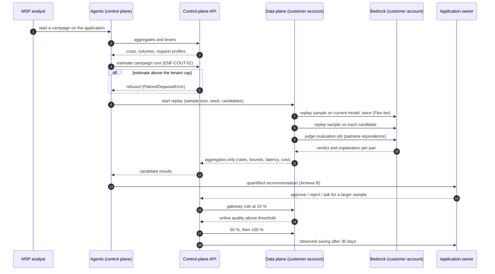

# Jauge — High-Level Design

**Service:** Jauge — FinOps for generative AI on Amazon Bedrock
**Vendor:** an AWS MSP, sold as a subscription plus a share of verified savings
**Event:** AWS MSP AI Hackathon — Track 2, *Deliver AI-Driven Outcomes for Customers*
**Document version:** 1.0 — 11 November 2026

> This is the High-Level Design (HLD) required by the hackathon submission
> checklist. It is written in English; the normative specification
> (`docs/fr/cahier-des-charges-finops-ia.md`) and the internal working notes are
> in French. Requirement identifiers (`EF-*`, `ENF-*`, `R*`) refer to that
> specification.

## 1. Context and objectives

### 1.1 The customer problem

A company runs generative AI in production on Amazon Bedrock. Its inference bill
grows every month and it cannot answer three questions:

1. **Which application and which team produce the spend?** The "Amazon Bedrock"
   line of the bill says nothing about who consumes it.
2. **Would a cheaper model do the same job — with evidence?** The most capable
   model was picked during the prototype and never revisited; nobody dares to
   change it because nobody can measure the quality cost of the change.
3. **Did the change actually reduce the bill, at constant volume?** Cost
   reductions are usually declared, not verified.

The levers that would cut the bill (prompt caching, a cheaper tier, batch, a
smaller model) stay unused because proving them safe takes time the product team
does not have.

### 1.2 What Jauge does

Jauge does three things, in this order:

| Verb | What it means | Where it runs |
|---|---|---|
| **Attribute** | Turn every inference dollar into a cost per application, team and request type, reconciled against the invoice | Control plane, from customer aggregates |
| **Prove** | Replay a reproducible sample of *real* requests against candidate models, judge the answers, and decide on measured quality | Data plane, inside the customer account |
| **Apply** | Shift traffic through a gateway rule in stages, re-judge online, roll back automatically, then verify the saving on the bill | Data plane (gateway rule) driven by the control plane |

The value is in the proof. "This model is cheaper" convinces nobody. "On 200 of
your real requests, 97 % of the answers are judged equivalent, and the bill drops
by $992 per month" closes the decision.

### 1.3 Objectives and indicators (specification §4)

| Indicator | Definition | Demo target | Production target |
|---|---|---|---|
| Inference bill reduction at equal quality | (cost per request before − after) × volume ÷ cost before, quality at the §13 threshold | Demonstrated on at least one application | 20–40 % on treated applications (**target**, to be validated) |
| Attribution coverage | Share of Bedrock spend tied to an application and a team | 100 % on demo accounts | > 95 % (**target**) |
| Reconciliation gap | Recalculated cost vs invoiced cost | Displayed | < 3 % (**target**) |
| Time to first insight | From onboarding to the first quantified recommendation | < 1 day | < 10 business days (**target**) |
| Savings verified | Monthly sum of savings observed on the bill | Displayed | Tracked per customer (**target**) |
| Recommendations applied | Applied ÷ issued | Displayed | > 60 % (**target**) |
| Rollbacks | Rollouts cancelled for quality | Displayed | < 5 % (**target**) |

Every number in this table is computed by code from logs and the invoice. No
language model computes any of them (`ENF-IA-01`).

## 2. Scope

### 2.1 In scope for the hackathon version

- Two fictional customers, each in its own AWS account, running demo
  applications that produce synthetic traffic.
- Attribution per application and per team from invocation logs and request
  metadata (`EF-ATT-01` … `EF-ATT-07`), reconciled against the invoice
  (`EF-ATT-06`).
- Four savings levers: oversized model, missing prompt cache, deferrable
  processing left on the Standard tier, over-long outputs (`EF-LEV-01` …
  `EF-LEV-04`, `EF-LEV-06`).
- Replay of a reproducible stratified sample on two or three candidates
  (`EF-REJ-01` … `EF-REJ-04`), LLM-as-a-judge evaluation plus deterministic
  checks (`EF-EVA-01` … `EF-EVA-04`).
- Quantified recommendation, human approval, staged rollout through an AgentCore
  Gateway rule (`EF-REC-01`, `EF-REC-02`, `EF-BAS-01` … `EF-BAS-03`), savings
  verification at constant volume (`EF-VER-01`).
- Web portal, monthly report, Strands agents on AgentCore Runtime.
- Single-turn model calls only.

### 2.2 Out of scope

**Post-hackathon target:** multi-turn conversations and tool-using agents
(trajectory replay, `EF-EVA-06`), model distillation for stable high-volume
tasks, provisioned capacity, prompt-level recommendations, SageMaker AI and
third-party models behind the gateway, per-team budgets and alerts.

**Explicitly excluded:** non-inference infrastructure cost optimisation — that is
the job of AWS FinOps Agent and of existing cost tooling; Jauge complements them
by covering what they do not, namely **model quality**. Also excluded: rewriting
the customer's applications, and any contractual commitment on the business
quality of the customer's answers.

## 3. Two planes, privacy by construction

### 3.1 The split

| Plane | AWS account | Holds |
|---|---|---|
| **Data plane** | Customer | Invocation logs, request and response text, replay execution, judge evaluation, replayed pairs, replay results |
| **Control plane** | MSP | Strands agents, portal, API, aggregates, scores, recommendations, rollout state, reports |

Request and response text never leaves the customer account (`ENF-CONF-01`).
This is enforced structurally, not by policy alone:

- The MSP cross-account role has **no read access** to the log bucket or the
  replay-results bucket. It can start the replay state machine and read Glue /
  Athena aggregate tables — nothing else (`ENF-SEC-01`).
- The only entity carrying text is `PaireRejoueeDataPlane`
  (`src/jauge/models/campaign.py`), and it is never returned by an agent tool nor
  by a control-plane API response. The control plane only ever sees
  `ResultatCandidat`: rates, confidence bounds, deterministic failures, latency,
  cost per request.
- The module docstring of `src/jauge/models/campaign.py` states this contract, so
  the constraint is visible where a developer would be tempted to break it.

### 3.2 Consequences accepted

- The portal cannot display a request/response pair. Human review (`EF-EVA-05`,
  `ENF-CONF-02`) therefore happens in an interface served **from the customer
  account**, by a reviewer the customer designated. Debugging a bad judge verdict
  needs a customer-side operator; the judge explanation stays next to the pair.
- Aggregates are **pushed** to the control plane by a customer-side Lambda, never
  pulled: the control plane has no read path into the customer account.

### 3.3 Data residency and personal data

Invocation logs contain whole requests and responses and may contain personal or
confidential data. The customer decides whether logging is enabled, the retention
period and the encryption key (`ENF-CONF-03`). The MSP acts as a processor; the
purposes (cost and quality measurement) are written into the contract.

## 4. AWS components and responsibilities

| Component | AWS service | Responsibility | Requirement |
|---|---|---|---|
| Invocation logs | Bedrock model invocation logging → S3 | Request, response, token counts, request metadata, service tier | `EF-ATT-02` |
| Analytics tables | Glue Data Catalog + Athena | Tables over invocation logs and over CUR 2.0 | `EF-ATT-05`, `EF-ATT-08` |
| Replay engine | Step Functions + Lambda (`src/jauge/replay/`) | Draw the sample, replay on current and candidate models, launch evaluation, store results | `EF-REJ-01` … `EF-REJ-04` |
| Evaluation | Bedrock model-evaluation jobs; decision rule in `src/jauge/evaluation/` | Judge verdict and explanation per pair; deterministic checks; decision | `EF-EVA-01` … `EF-EVA-03` |
| Price table | `data/pricing/` JSON loaded by `src/jauge/pricing_data/` | Dated prices per model, region and tier, validated at load | `EF-ATT-04` |
| Routing | AgentCore Gateway (inference target + rules) | Staged rollout without touching application code | `EF-BAS-01` … `EF-BAS-03` |
| Agents and their tools | Strands Agents on AgentCore Runtime + AgentCore Gateway + Lambda (`src/jauge/agents/`) | Orchestration, interpretation, writing; tools read aggregates, estimate and start a campaign | §12 |
| Portal | CloudFront + S3 + API Gateway + Lambda + Cognito | MSP and customer UI | `EF-RAP-01`, `EF-RAP-02`, `EF-POR-01`, `EF-POR-02` |
| State | DynamoDB (+ S3 for reports) | Aggregates, campaigns, recommendations, rollouts, audit | `EF-ADM-02` |
| Infrastructure as code | AWS CDK (MSP) + one CloudFormation template per customer | Reproducibility | `ENF-REP-01` |
| Cost | CUR 2.0 export, cost allocation tags, AWS Budgets | Invoiced dollars per tag (reconciliation source) and a spend alarm per account | `EF-ATT-06`, `EF-ATT-08` |

Architecture diagram: [`ARCHITECTURE.md`](ARCHITECTURE.md) and
[`architecture.mmd`](architecture.mmd) / [`architecture.svg`](architecture.svg).

## 5. Data model

The shared vocabulary lives in `src/jauge/models/` and is used by every module
(no module redefines an entity).

| Entity | Key fields | Code |
|---|---|---|
| Tenant | `id`, `compte_aws` (12 digits), `region_principale`, `role_arn`, `external_id`, `formule`, `plafond_campagne_usd` (default $50), `schema_attribution` (`dimensions`, allowed team/environment values, default application), `modeles_autorises` | `models/tenant.py` |
| Application | `id`, `tenant_id`, `equipe`, `environnement`, `modele_actuel`, `seuil_qualite` (0.95), `seuil_intervalle_bas` (0.90), `relecture_humaine_autorisee`, `passe_par_passerelle`, `identifiant_passerelle` | `models/tenant.py` |
| Price row | `modele_id`, `region`, `niveau`, `date_effet`, entry/output/cache-write/cache-read price per 1 000 tokens | `models/pricing.py` |
| Daily aggregate | `tenant_id`, `application_id`, `equipe`, `environnement`, `modele_id`, `jour`, request and token counts, `cout_recalcule_usd`, p50/p95 latency | `models/cost.py` |
| Daily reconciliation | recalculated cost, invoiced cost, absolute and percentage gap, unattributed share and causes, `conforme` (< 3 %) | `models/cost.py` |
| Lever | `type_levier` (8 families), `statut`, `indices`, `action_proposee`, `preuve_exigee`, `economie_mensuelle_estimee_usd`, `candidats_suggeres` | `models/lever.py` |
| Campaign | `modeles_candidats`, `taille_echantillon` (default 200, 10–2000), `graine_aleatoire` (default 42), `modele_juge_id`, `statut`, estimated and actual cost | `models/campaign.py` |
| Result per candidate | `taux_equivalence`, `intervalle_confiance_bas/haut`, `auto_accord_modele_actuel`, `echecs_deterministes`, `accord_juge_humain`, cost per request, p50/p95, failing families | `models/campaign.py` |
| Replayed pair | request text, reference answer, candidate answer, judge score and explanation, deterministic check flag — **data plane only** | `models/campaign.py` |
| Recommendation | Annexe B shape: quality / cost / latency blocks, `risks`, `rolloutPlan` (10, 50, 100), `status`, `approvedBy` | `models/recommendation.py` |
| Rollout | `regle_passerelle_id`, `palier_actuel_pourcentage`, `qualite_en_ligne_mesuree`, `seuil_alerte`, `annule_automatiquement`, `motif_annulation` — plus `VerificationEconomie`: cost per request before/after, volume, observed vs expected saving, gap | `models/recommendation.py` |

Persistence contract: `src/jauge/store/protocol.py` (`Store` protocol, every read
takes `tenant_id` first — `ENF-SEC-02`). `MemoryStore` implements it for tests and
the local demo; a DynamoDB adapter is the production target.

Price rows are **dated**: a price change creates a new row with its effective
date and past costs are never recomputed (`EF-ATT-04`). `TableTarifs.trouver`
selects the most recent row at or before the requested date and falls back to the
Standard tier when a Flex/Priority row is missing, so a missing tier never
silently produces zero cost.

## 6. Replay campaign flow

Step by step:

1. **Sample** (`EF-REJ-01`): 200 requests over 14 days, stratified by length and
   request-type tag, reproducible from a seed (`graine_de`), sensitive requests
   excluded.
2. **Estimate and cap** (`ENF-COUT-01`): sample × (2 current-model runs + 1 run per
   candidate) × average cost at the Flex rate, plus judge calls — shown before
   launch, refused above the tenant cap (`PlafondDepasseError`).
3. **Replay** (`EF-REJ-02`, `EF-REJ-03`): same parameters as the original call; the
   current model runs **twice** (fresh reference + its own variability,
   `EF-EVA-04`), in the customer account, on the Flex tier or in batch.
4. **Measure** (`EF-REJ-04`): tokens, cost and latency per response, cost
   recomputed with the dated price table.
5. **Judge and check** (`EF-EVA-01`, `EF-EVA-02`): pairwise equivalence plus
   deterministic checks per task type.
6. **Aggregate** (`EF-EVA-03`): equivalence rate with a Wilson interval,
   self-agreement of the current model, deterministic failures, judge/human
   agreement.
7. **Recommend and decide** (`EF-REC-01`, `EF-REC-02`): Annexe B document, all
   numbers computed by code, explicit human approval — without it rollout is
   impossible (`ApprobationRequiseError`).
8. **Roll out and verify** (`EF-BAS-01` … `EF-BAS-03`, `EF-VER-01`).

## 7. Attribution model and bill reconciliation

### 7.1 Three layers, one number

| Layer | Mechanism | Grain |
|---|---|---|
| Invoiced dollars | Cost allocation tags on application inference profiles + CUR 2.0 | Usage type per day |
| Request detail | Bedrock model invocation logs (request metadata key-value tags) | One call |
| Jauge's number | Tokens × dated price table, aggregated per application / team / model / day | One day |

Tags appear in the invocation logs but **not** on the bill, so Jauge converts
tokens into cost itself (`EF-ATT-04`) and reconciles the result against the
invoiced dollars (`EF-ATT-06`).

### 7.2 Aggregation

`engine/attribution.agreger_requetes` turns a day of request rows into one
`AgregatQuotidien`: request count, input/output/cache-write/cache-read token
totals, recalculated cost (rounded to 4 decimals) and p50/p95 latency.

### 7.3 Reconciliation and unattributed spend

`engine/attribution.rapprocher_facture` compares the recalculated total with the
invoiced total, returns the absolute and relative gap, the unattributed share and
its causes (`EF-ATT-07`), and flags the day as `conforme` when the gap is under
the 3 % production target. Known causes of unattributed spend:

- calls without an application tag (they fall back to `application_par_defaut`),
  and calls through an endpoint that is not logged (`bedrock-mantle`);
- tag propagation delay in Cost Explorer / CUR 2.0 (up to 24 h, not retroactive);
- price-table rows missing for a model/region/tier combination.

The gap is displayed, never hidden. An honest 2 % gap is a feature: it tells the
customer where the logs are incomplete.

### 7.4 Why not just read CUR?

CUR gives invoiced dollars per tag, at a daily usage-type grain, with a
propagation delay and no request detail: it cannot say which request type drives
the cost, nor feed a replay sample. Jauge uses CUR for reconciliation
(`EF-ATT-08`) and logs for everything else.

## 8. Quality measurement method

### 8.1 Sample

200 requests per application, over 14 days, stratified by length and request
type, reproducible from a seed, sensitive requests excluded. The figure is not
arbitrary: `engine/stats.taille_echantillon_minimale` shows that estimating a rate
near 95 % with a ±3 pt margin needs that order of magnitude.

### 8.2 Judge

- A model **different from the candidate** and at least as capable as the current
  model.
- Custom metric: *does the candidate answer provide the same service as the
  reference answer?* Verdict plus explanation, kept per pair.
- The judge is fed only request/response pairs; it never sees Jauge's agents'
  instructions (`ENF-IA-03` — replayed content is data, never an instruction).

### 8.3 Deterministic checks

Per task type: valid JSON, schema respected, identical label, output length
within bounds, refusal detection. A candidate that fails a **critical**
deterministic check is rejected regardless of its judge score (`EF-EVA-02`). This
is the safety net against a judge that is too generous.

### 8.4 Decision rule

A candidate is proposed only if all three conditions hold:

1. Equivalence rate ≥ the application threshold (95 % by default —
   `Application.seuil_qualite`).
2. The **lower bound** of the 95 % confidence interval > 90 %
   (`Application.seuil_intervalle_bas`).
3. No critical deterministic check fails.

Wilson intervals (`intervalle_wilson`, z = 1.95996) are used rather than the
normal approximation: they stay stable for small samples and rates near 1, which
is exactly the case at hand (97 % on 200 requests).

### 8.5 Self-agreement of the current model

The candidate rate is always shown next to the current model's rate **compared to
itself** (`auto_accord_modele_actuel`). If the current model is only 96 %
equivalent to itself, a candidate at 95 % is excellent, not marginal. Without
this column, every recommendation looks riskier than it is.

### 8.6 Judge reliability

- A 30-pair sub-sample is reviewed by a human when the application allows it; the
  judge/human agreement appears in the recommendation (`EF-EVA-05`).
- Judge explanations are kept for every pair, data plane only.
- Online, the same judge keeps scoring a sample of real traffic at each rollout
  stage — a degraded judge shows up as an inconsistent verdict distribution.

### 8.7 Declared limits

- **Creative tasks**, where two good answers legitimately differ: the threshold is
  set with the customer and human review is recommended.
- **Long conversations and tool-using agents**: not covered in v1.
- **Rare cases**: 200 requests do not see them. Staged rollout plus online
  monitoring cover that risk.
- **Judge bias**: mitigated by deterministic checks, human review and the
  self-agreement column, not eliminated.

## 9. Staged rollout and rollback

### 9.1 Gateway rule

An AgentCore Gateway rule can serve a different model than the one requested,
split traffic by weight and define a fallback chain. The application keeps its
code and its model name; the switch and the rollback are a rule change, in
seconds. Rules are created at priority 100 with a `matchModels` condition on the
requested model and a `routeToTarget` action (Annexe C).

### 9.2 Stages and automatic rollback

`rolloutPlan` defaults to **[10, 50, 100]** (`Recommandation.rolloutPlan`). At each
stage a sample of real traffic is re-judged and compared with the threshold; from
50 % on, the error rate is watched as well; at 100 % the cost per request is
measured.

`BasculeProgressive` carries `qualite_en_ligne_mesuree`, `seuil_alerte` (0.90 by
default) and `annule_automatiquement`. Below the alert threshold, or on a rising
error rate, the rule is removed without human intervention (`EF-BAS-03`) and an
alert is sent: a rollback is never a judgement call at 3 a.m.

### 9.4 Applications outside the gateway, and verification

An application calling Bedrock directly still gets attribution, lever detection
and replay; only automatic rollout is unavailable, so Jauge opens a ticket
describing the model-id change (`EF-BAS-04`).

30 days later, cost per request before and after is compared **at constant
volume** (`EF-VER-01`) and checked against tagged invoiced dollars (`EF-VER-02`).
`VerificationEconomie` records the observed saving, the expected saving and the
gap.

## 10. Security

| Concern | Measure | Requirement |
|---|---|---|
| Cross-account access | Least-privilege role with an **external ID**, created by the customer's own CloudFormation template | `ENF-SEC-01` |
| Log confidentiality | The role has **no read access** to the log and replay-result buckets | `ENF-CONF-01` |
| Tenant isolation | Every store and API read takes `tenant_id` first and filters on it; negative tests (customer B on customer A's data → refusal) are mandatory for every data-exposing module | `ENF-SEC-02`, `R11` |
| Encryption, retention | KMS at rest (customer-managed keys for logs), TLS in transit, retention configurable per customer | `ENF-SEC-03`, `ENF-CONF-03` |
| Human review | Performed inside the customer account by a customer-designated reviewer | `ENF-CONF-02` |
| Human approval | No rollout without approval (`ApprobationRequiseError`) | `ENF-IA-02` |
| Prompt injection | Replayed request content is data; agents' tools return aggregates and identifiers only | `ENF-IA-03` |
| Audit trail | Every campaign, approval and created rule is logged; API calls are visible in the customer's CloudTrail | `EF-ADM-02` |
| Campaign spend | Cost estimated before launch, capped per tenant | `ENF-COUT-01` |
| Candidate models | Restricted to the customer-approved list (`Tenant.modeles_autorises`) | §12.3 |

Error taxonomy: `JaugeError` and subclasses in `src/jauge/common/errors.py` —
`CloisonnementError` (tenant violation), `PlafondDepasseError` (cost cap),
`ApprobationRequiseError` (missing approval), `EtatIncompatibleError` (illegal
state transition), `TarifInconnuError` (missing price), `ValidationError`,
`IntrouvableError`, `ServiceIndisponibleError`. Typed errors mean a refusal is
never a silent no-op.

## 11. Observability

- **Traces** of every agent run and every replay task (`ENF-OBS-01`), campaign id
  as the correlation key.
- **Alarms** on replay and evaluation failures, on a rollout below threshold, and
  on the reconciliation gap crossing 3 %.
- **Cost**: an AWS Budgets alarm per account; campaign cost tracked as estimated
  vs actual (`Campagne.cout_estime_usd` / `cout_reel_usd`).
- **Audit log** in DynamoDB, append-only, per tenant (`EF-ADM-02`).

## 12. Architecture decisions and accepted trade-offs

| # | Decision | Alternative rejected | Why | Trade-off accepted |
|---|---|---|---|---|
| D1 | Two planes, text stays in the customer account | Centralise logs at the MSP | `ENF-CONF-01` is a hard requirement; a single log lake would make Jauge a data processor for content | No portal-side debugging of pairs; no cross-customer quality benchmark on raw text |
| D2 | AgentCore Gateway rules for the switch | Patch application code / model id in config | Zero code change, instant rollback, weighted split | Depends on gateway behaviour with the APIs the apps use (§23 Q4–Q5); fallback is a ticket (`EF-BAS-04`) |
| D3 | LLM-as-a-judge + deterministic checks | Judge alone; human review alone | Judge alone drifts; human alone does not scale | Judge bias mitigated but not eliminated; §13.5 controls |
| D4 | Wilson interval, 200-request sample | Normal approximation; bigger sample | Stable for rates near 1 and small n; 200 keeps campaign cost low | Wide intervals on rare failures; larger sample on demand |
| D5 | Dated price table, own cost computation | Read cost from CUR only | Request-level cost is needed for replay and per-request economics | Recalculation gap to explain (§7.3), table to maintain |
| D6 | All numbers computed in code, agents write text only | Let agents compute/estimate | `ENF-IA-01`; auditability; a wrong number must be reproducible | Agents are less "autonomous" — deliberate |
| D7 | Rollout is a deterministic API action, never an agent action | Agent-triggered rollout | `ENF-IA-02`; an LLM must not move production traffic | One more human click in the flow |
| D8 | In-memory store first, DynamoDB adapter alongside; static portal with no build step; Mermaid diagrams as source | DynamoDB and a bundled SPA from day one | Tests and the demo run offline at zero cost; the portal deploys as-is from S3; diagrams are reviewable text in the repository | Two implementations of the store protocol to keep in sync; less UI polish; vanilla-JS discipline |
| D9 | Single-turn requests in v1 | Multi-turn / tool trajectories | Replay fidelity: tools and external context cannot be reproduced reliably yet | Agents and chat applications are out of the first version |

## 13. Known limits and points to confirm

### 13.1 Known limits

Measurement limits — replay fidelity, rare cases, judge bias — are declared in
§8.7. The remaining limits are about data and money:

- Log-based attribution only covers calls that go through `bedrock-runtime` with
  invocation logging enabled; unlogged endpoints appear as unattributed spend.
- Tag propagation into CUR 2.0 takes up to 24 h and is not retroactive, so the
  reconciliation gap is structurally wider on the first days of a new tag.
- Campaign cost is estimated from an average request cost; a heavy-tailed
  distribution can make the actual cost exceed the estimate.

### 13.2 Points to confirm before submission (specification §23)

| # | Question | Impact if unresolved |
|---|---|---|
| 1 | Is the organisation enrolled in the AWS Partner Network? | Track 2 eligibility |
| 2 | Exact field names in invocation logs (tokens, identity, request metadata, service tier) | Ingestion parser (M1) |
| 3 | Price source per model/region/tier: Pricing API or a hand-maintained table | Price table accuracy (M2) |
| 4 | Weighted-split syntax inside a gateway rule | 10 % / 50 % stages (M6) |
| 5 | Does the gateway rule work with the APIs the demo applications use? | Automatic rollout; fallback is a ticket |
| 6 | Built-in metrics available in evaluation jobs, dataset format with supplied answers | Evaluation design (M5) |
| 7 | Models available on the Flex tier and in batch in the chosen region | Replay cost (M4) |
| 8 | Can AWS FinOps Agent be called programmatically? Regions, quotas, preview price | Optional "frontier agent" variant |
| 9 | Tag appearance delay in Cost Explorer / CUR 2.0 | Reconciliation interpretation (M1) |
| 10 | Commercial assumptions (savings share, target reduction) | Pricing page only — not the demo |

None of items 1–9 blocks the local demo: the demo runs on the in-memory store
with synthetic logs and fake adapters.

## 14. Implementation status

This HLD describes the target design. What `main` contains today is the shared
library — entities (`src/jauge/models/`), the typed error hierarchy and id helpers
(`src/jauge/common/`), the deterministic engine for request cost, daily
aggregation, bill reconciliation, Wilson intervals and saving arithmetic
(`src/jauge/engine/`), the store contract with its in-memory implementation
(`src/jauge/store/`) — plus four feature modules: evaluation (judge prompt and
adapters, deterministic checks, the decision rule of §8.4 with its relative
reading of the current model, human review sub-sample), replay (stratified
reproducible sampling, executor, cost estimate and cap, Step Functions
definition), the dated price-table loader, and the Strands agents (orchestrator
plus four specialists as tools, guardrails, schema-validated outputs, traces and
sessions). All of it is covered by offline tests, with no AWS call.

The data plane, the control plane, the demo and the end-to-end acceptance are
delivered module by module through their own pull requests (`docs/MODULES.md`,
M1–M16). The README carries the same status table, and
`docs/TEST-INSTRUCTIONS.md` marks every command that depends on a planned module
as **planned**, so a judge is never told to run something that does not exist yet.

## 15. Glossary

| Term | Meaning |
|---|---|
| Inference | A model call that produces an answer |
| Token | The billed text unit, input and output |
| Invocation log | Record of a model call: request, response, metadata |
| Application inference profile | Tag-able Bedrock resource that lets an application be found on the bill (CUR 2.0 = AWS Cost and Usage Report) |
| Flex tier | Reduced-price service tier for latency-tolerant work |
| Replay | Sending an already-received request to another model, to compare |
| Judge model | A model that scores another model's answer |
| Functional equivalence | The candidate answer provides the same service as the reference answer |
| Staged rollout | Progressive traffic shift to the new model |
| Data plane / control plane | What runs in the customer account with the data / what runs at the MSP to drive it — HLD is this document |
