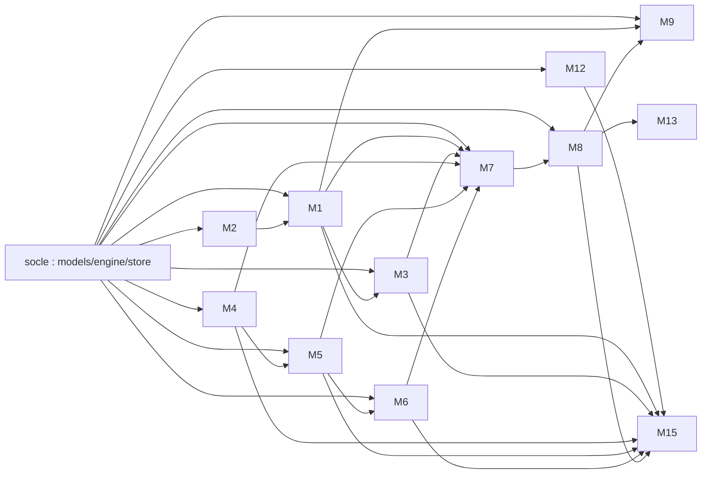

# Chantier Jauge — découpage en modules et contrats

Ce fichier est la **carte du chantier**. Chaque module a un propriétaire
(agent ou humain), des chemins qui lui appartiennent en propre, et une
définition de « fini ». L'objectif : que plusieurs personnes (ou agents)
travaillent en parallèle sans jamais se marcher sur les mêmes fichiers.

Référence normative : [`docs/fr/cahier-des-charges-finops-ia.md`](fr/cahier-des-charges-finops-ia.md)
(numéros de chapitres et références `EF-*`, `ENF-*`, `R*` cités ci-dessous).

## Règles non négociables

1. **Tailles** : tout fichier < 500 lignes, toute fonction < 50 lignes
   (`python3 scripts/check_limits.py` doit rester vert — job CI `limits`).
2. **Zéro duplication** : un helper existe dans `src/jauge/engine/` ou
   `src/jauge/common/` ? On l'importe, on ne le recopie pas.
3. **Fichiers partagés verrouillés** : `pyproject.toml`, `uv.lock`,
   `src/jauge/common/**`, `src/jauge/models/**`, `src/jauge/engine/**`,
   `src/jauge/store/protocol.py`, `tests/conftest.py`, `.github/**`,
   `.mergify.yml`, `docs/MODULES.md`.
   Un besoin d'évolution (nouveau champ, nouvelle dépendance) → **issue ou
   commentaire de PR**, jamais un edit sauvage dans une PR de module.
4. **Aucun chiffre calculé par un LLM** (ENF-IA-01) : les agents reçoivent des
   nombres déjà calculés et ne rédigent que du texte.
5. **Le texte des requêtes ne sort pas du compte client** (ENF-CONF-01) :
   `PaireRejoueeDataPlane` n'est jamais renvoyé par un outil d'agent ni par
   l'API du plan de contrôle.
6. **Cloisonnement** (ENF-SEC-02) : toute fonction de lecture prend
   `tenant_id` en premier argument et filtre dessus. Les tests négatifs R11
   sont obligatoires pour chaque module qui expose des données.
7. **Tests** : chaque module livre ses tests (`tests/<module>/`) et passe en
   local avant PR. Commandes : `uv sync --all-groups && uv run pytest -q`.
8. **Commentaires et docstrings en français** ; les livrables du hackathon
   (`README.md`, `docs/HLD.md`, `docs/ARCHITECTURE.md`, portail) **en anglais**.
9. **Pas de push direct sur `main`** : branche `feat/<module>` + PR, la file
   Mergify merge. Ne jamais rebaser ou supprimer la branche d'un autre.

## Socle déjà livré (à ne pas modifier)

| Chemin | Contenu |
|---|---|
| `src/jauge/models/` | Entités pydantic : `tenant`, `pricing`, `cost`, `lever`, `campaign`, `recommendation` |
| `src/jauge/common/` | `errors` (hiérarchie `JaugeError`), `ids` (identifiants, graines, empreintes) |
| `src/jauge/engine/` | `calculator` (coût Annexe D + table datée), `attribution` (agrégats, rapprochement), `stats` (Wilson, percentiles, économies) |
| `src/jauge/store/` | `protocol.Store` (contrat) + `memory.MemoryStore` (tests/démo) |
| `tests/` | Fixtures partagées + tests du socle |
| `.github/workflows/ci.yml` | Jobs `lint`, `limits`, `test`, `iac` (≤ 5 min chacun) |

## Modules à livrer

| # | Module | Branche | Chemins possédés | Spéc. | Définition de « fini » |
|---|---|---|---|---|---|
| M1 | Attribution & journaux | `feat/attribution` | `src/jauge/attribution/**`, `tests/attribution/**` | §8.2, EF-ATT-01..08 | Lecture des journaux d'invocation (S3/JSON) → `MetriquesRequete` + étiquettes ; agrégation ; rapprochement CUR 2.0 ; part non attribuée et ses causes ; tests sur fixtures |
| M2 | Table des tarifs | `feat/pricing-data` | `data/pricing/**`, `src/jauge/pricing_data/**`, `tests/pricing_data/**` | EF-ATT-04, §23 Q3 | Table datée en JSON/YAML pour les modèles de la démo (3 modèles × 2 niveaux × 1 région), chargeur validant, tests de date d'effet |
| M3 | Leviers d'économie | `feat/levers` | `src/jauge/levers/**`, `tests/levers/**` | Annexe A, EF-LEV-01..06 | 4 règles M + 3 règles S, économie estimée par levier, classement décroissant, tests par règle |
| M4 | Rejeu (échantillon + exécution) | `feat/replay` | `src/jauge/replay/**`, `infra/client-account/replay/**`, `tests/replay/**` | §13.1-13.2, EF-REJ-01..04 | Tirage stratifié reproductible ; exécuteur (adaptateur Bedrock `Converse`) ; mesure jetons/coût/latence ; estimation de coût + plafond (ENF-COUT-01) ; définition Step Functions ; tests avec adaptateur fictif |
| M5 | Évaluation & décision | `feat/evaluation` | `src/jauge/evaluation/**`, `tests/evaluation/**` | §13.3-13.5, EF-EVA-01..05 | Modèle juge (prompt + adaptateur tâche d'évaluation Bedrock) ; contrôles déterministes par type de tâche ; taux + intervalle ; auto-accord du modèle actuel ; relecture humaine (30 paires) et accord juge/humain ; règle de décision §13.4 |
| M6 | Bascule & vérification | `feat/rollout` | `src/jauge/rollout/**`, `tests/rollout/**` | §8.6, EF-BAS-01..04, EF-VER-01..02, Annexe C | Création de règle de passerelle (statique + pondérée) ; paliers 10/50/100 ; rejugement en ligne ; rollback automatique ; ticket pour app hors passerelle ; vérification à volume constant |
| M7 | Agents Strands | `feat/agents` | `src/jauge/agents/**`, `tests/agents/**` | §12, EF-RAP-04 | Orchestrateur + 4 spécialistes en « agents comme outils » ; `ports.py` (protocoles) + jeu d'essai ; sorties structurées validées par schéma ; interruption de validation humaine ; traces ; tests **sans appel réseau** |
| M8 | API du plan de contrôle | `feat/api` | `src/jauge/api/**`, `tests/api/**` | §15, EF-POR-01, ENF-SEC-02 | Tous les points d'API du §15 ; authentification + rôles ; cloisonnement avec tests négatifs R11 ; audit EF-ADM-02 ; paramètres EF-ADM-01 ; tests `TestClient` |
| M9 | Rapports | `feat/reports` | `src/jauge/reports/**`, `tests/reports/**` | EF-RAP-01..03 | Rapport mensuel : chiffres calculés, synthèse rédigée via interface LLM ; sorties Markdown + JSON ; adaptateur S3 ; tests sans réseau |
| M10 | Infra plan de contrôle (CDK) | `feat/infra-control` | `infra/control-plane/**`, `tests/infra/**` | §11.2, ENF-REP-01 | CDK Python : API GW + Lambda, Cognito, DynamoDB, CloudFront/S3 (portail), AgentCore Runtime/Gateway, AWS Budgets ; tests `aws_cdk.assertions` (marqueur `infra`) |
| M11 | Infra compte client (CFN) | `feat/infra-client` | `infra/client-account/**` (hors `replay/`), `docs/deploy-client.md` | EF-ATT-01, ENF-SEC-01, §8.1 | Un seul gabarit CloudFormation par client : rôle inter-comptes à moindre privilège + external ID (**aucune lecture des compartiments de journaux**), S3 journaux + KMS, Glue/Athena, Step Functions, Budgets ; `cfn-lint` vert ; script de déploiement |
| M12 | Démo & trafic synthétique | `feat/demo` | `demo/**`, `tests/demo/**` | §18.1 | 3 applications client A (assistant, classement, résumé nocturne) + 1 client B ; générateur de trafic produisant des journaux d'invocation et des lignes CUR réalistes ; amorçage du store ; aucune donnée réelle |
| M13 | Portail | `feat/portal` | `portal/**`, `tests/portal/**` | EF-RAP-01..02, EF-POR-01..02 | SPA statique **sans étape de build** (JS/CSS vanilla) servie par l'API : tableaux de bord client et parc, approbation d'une recommandation, suivi de bascule, relecture humaine ; compte de démo pour les juges |
| M14 | Documentation & soumission | `feat/docs` | `docs/HLD.md`, `docs/ARCHITECTURE.md`, `docs/DEMO-SCRIPT.md`, `docs/SUBMISSION.md`, `README.md` | §19, §18.2 | En **anglais** : HLD, schéma d'architecture (mermaid + SVG), script vidéo 3 min, instructions de test pour les juges, checklist de soumission |
| M15 | Recette bout-en-bout | `feat/recette` | `tests/recette/**` | §22 | Scénarios R1–R13 en pytest sur `MemoryStore` + adaptateurs fictifs, y compris les tests négatifs de sécurité R10/R11 |
| M16 | Résolveur Hermes | `feat/hermes-resolver` | `.github/hermes/**`, `.github/workflows/hermes-*.yml` | runbook interne | Portage du résolveur de conflits (rebase + résolution + validation par la toolchain du dépôt) ; PR **draft** ; selftests sans secrets |

## Dépendances entre modules



Chaque module code contre les **contrats du socle** (`models`, `engine`,
`store.protocol`), pas contre l'implémentation d'un autre module. Là où un
module a besoin d'un service qui n'existe pas encore (M7 → M1/M4/M5), il définit
un protocole local dans son propre paquet (`ports.py`) et un jeu d'essai pour
ses tests ; le câblage réel se fait dans la PR d'intégration (M15).

## Commandes locales

```bash
uv sync --all-groups          # dépendances (dev + infra + agents)
uv run pytest -q              # tests hors infra
uv run pytest -q -m infra     # tests CDK/CloudFormation
uv run ruff check . && uv run ruff format --check .
python3 scripts/check_limits.py
bash scripts/ci-local.sh      # équivalent complet de la CI
```
