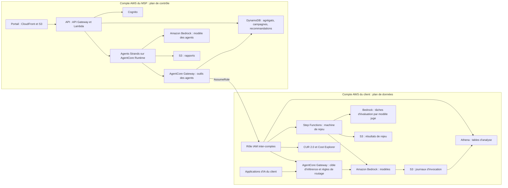
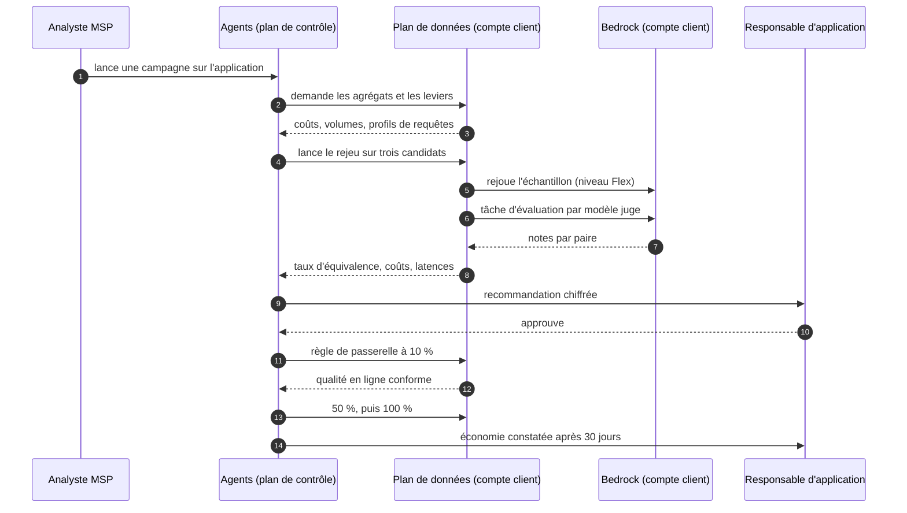

# Cahier des charges — FinOps de l'IA

**Nom de travail : Jauge** (à changer librement)
Version 1.0 du 11 novembre 2026 — Hackathon AWS MSP AI, Track 2

> Ce document est en français pour le travail interne. Tous les livrables de la soumission (description, vidéo, schéma d'architecture, document de conception) doivent être en anglais.
>
> Les faits marqués **(vérifié)** ont été lus dans la documentation AWS le 11 novembre 2026 (sources en annexe E). Tout ce qui reste à confirmer est regroupé au chapitre 23.

---

## 1. Fiche d'identité

| Élément | Valeur |
|---|---|
| Track | 2 — Deliver AI-Driven Outcomes for Customers |
| Famille d'exemples visée | « AI Cost & Performance Optimization » : gestion du coût des jetons, choix du bon modèle, réglage des performances |
| Prix spécial visé | Best Strands SDK Implementation |
| Variante | Best AWS Frontier Agents Application, si AWS FinOps Agent (préversion) peut être intégré par programme |
| Services IA AWS | Strands Agents, Amazon Bedrock (journaux d'invocation, évaluation par modèle juge, niveaux de service, traitement par lots), AgentCore Runtime et Gateway |
| Client final | Entreprise qui a une ou plusieurs applications d'IA générative en production sur Amazon Bedrock |
| Vendeur | Le MSP, sous forme d'abonnement avec part des économies |
| Échéance de soumission | Vendredi 11 décembre 2026, 12h00 PT (21h00 à Paris) |
| Fin du jugement | 22 janvier 2027 : la solution doit rester en ligne jusque-là |

## 2. Résumé

Une entreprise qui met de l'IA générative en production reçoit une facture d'inférence qui grossit vite, sans savoir quelle application ou quelle équipe la produit, ni si un modèle moins cher ferait le même travail.

Jauge est un service managé vendu par un MSP. Il fait trois choses :

1. **Attribuer** chaque dollar d'inférence à une application, une équipe et un type de requête.
2. **Prouver** qu'un modèle moins cher convient, en rejouant un échantillon de requêtes réelles sur des modèles candidats et en mesurant la qualité.
3. **Appliquer** le changement progressivement, puis vérifier l'économie sur la facture.

La valeur est dans la preuve. Dire « ce modèle coûte moins cher » ne décide personne. Montrer « sur 200 de vos requêtes réelles, 97 % des réponses sont jugées équivalentes, et la facture baisse de tant » permet de décider.

## 3. Contexte et problème

### 3.1 Le problème du client final

- **Facture opaque :** la ligne « Amazon Bedrock » de la facture ne dit pas qui consomme.
- **Modèle choisi une fois pour toutes :** l'équipe a pris le modèle le plus capable pendant le prototype et ne l'a jamais remis en cause.
- **Peur de dégrader :** personne n'ose changer de modèle, faute de moyen de mesurer la qualité.
- **Leviers ignorés :** cache de prompts, niveau de service à prix réduit, traitement par lots restent inutilisés.
- **Pas de temps :** l'équipe produit livre des fonctions, elle ne fait pas de bancs d'essai.

### 3.2 Ce qu'AWS fournit déjà (vérifié)

| Sujet | Ce qui existe |
|---|---|
| Attribution sur la facture | Quatre mécanismes natifs donnent des dollars facturés dans Cost Explorer et CUR 2.0 : attribution par identité IAM, profils d'inférence d'application (étiquettes), projets et espaces de travail (point d'accès `bedrock-mantle`). Leur grain le plus fin est le type d'usage par jour. |
| Détail par requête | Les journaux d'invocation de modèle enregistrent la requête complète, la réponse et les métadonnées, vers CloudWatch Logs ou S3, dans le même compte et la même région. Ils sont désactivés par défaut. |
| Étiquettes par requête | Des métadonnées clé-valeur peuvent être attachées à chaque appel. Elles apparaissent dans les journaux d'invocation, pas sur la facture : il faut convertir soi-même les jetons en coût. |
| Limite des journaux | Seuls les appels passant par `bedrock-runtime` sont journalisés (`Converse`, `ConverseStream`, `InvokeModel`, `InvokeModelWithResponseStream`, et les API compatibles OpenAI sur ce point d'accès). Les appels par `bedrock-mantle` ne le sont pas. |
| Niveaux de service | Quatre niveaux : Reserved, Priority, Standard, Flex. Flex offre une remise pour les traitements qui tolèrent un délai. Le paramètre `service_tier` se règle à chaque requête. |
| Autres leviers | Traitement par lots, cache de prompts, distillation de modèle, API de comptage des jetons. |
| Évaluation | Des tâches d'évaluation utilisent un modèle juge pour noter les réponses d'un autre modèle, avec des métriques intégrées ou personnalisées. On peut fournir ses propres réponses déjà générées : Bedrock saute alors l'étape d'invocation. |
| Routage | Une passerelle AgentCore peut servir de point d'entrée unique vers les modèles. Une règle peut faire servir un autre modèle que celui demandé, répartir le trafic par poids et définir une chaîne de repli. |
| AWS FinOps Agent (préversion) | Agent Frontier qui répond aux questions de coût, enquête sur les anomalies de coût, produit des rapports récurrents et résume les recommandations d'optimisation, avec envoi vers Jira ou Slack. Il s'appuie sur Cost Explorer, Cost Anomaly Detection, Cost Optimization Hub et Compute Optimizer. |

### 3.3 Ce qui manque

| Manque | Réponse de Jauge |
|---|---|
| Les mécanismes d'attribution sont à choisir et à assembler | Un schéma d'attribution posé à la mise en service, et un rapprochement entre le détail par requête et les dollars facturés |
| Aucun outil ne dit « ce modèle moins cher suffit pour cette application » | Rejeu de requêtes réelles et mesure de la qualité |
| Les leviers d'économie ne sont pas détectés | Règles de détection sur les journaux, avec économie estimée |
| Changer de modèle demande une modification de code | Bascule par règle de passerelle, sans toucher à l'application quand elle passe par la passerelle |
| Personne ne vérifie que l'économie est réelle | Comparaison avant et après sur la facture, à volume constant |
| Tout cela est à refaire chez chaque client | Un socle reproductible, piloté par le MSP |

## 4. Objectifs et indicateurs

| Indicateur | Définition | Cible démo | Cible production |
|---|---|---|---|
| Baisse de la facture d'inférence à qualité égale | (Coût par requête avant moins coût par requête après), multiplié par le volume, divisé par le coût avant. Qualité égale : seuil du chapitre 13 atteint | Démontrée sur au moins une application | 20 à 40 % sur les applications traitées (hypothèse à valider) |
| Couverture d'attribution | Part de la dépense Bedrock rattachée à une application et une équipe | 100 % sur les comptes de démonstration | Plus de 95 % |
| Écart de rapprochement | Écart entre le coût recalculé depuis les journaux et le coût facturé | Affiché | Moins de 3 % |
| Délai d'analyse | Entre la mise en service et la première recommandation chiffrée | Moins de 1 jour | Moins de 10 jours ouvrés |
| Économie réalisée et vérifiée | Somme mensuelle des économies constatées sur la facture | Affichée | Suivie par client |
| Recommandations appliquées | Recommandations appliquées, divisées par les recommandations émises | Affiché | Plus de 60 % |
| Retours arrière | Bascules annulées pour cause de qualité | Affiché | Moins de 5 % |

Tous les chiffres sont calculés par le code à partir des journaux et de la facture. Le modèle de langage n'en calcule aucun.

## 5. Périmètre

### 5.1 Inclus dans la version du hackathon

- Deux clients fictifs, chacun dans son compte AWS, avec des applications de démonstration qui produisent du trafic.
- Attribution par application et par équipe à partir des journaux d'invocation et des métadonnées de requête.
- Rapprochement avec la facture.
- Détection de quatre leviers : modèle surdimensionné, cache de prompts absent, traitement différable resté au niveau Standard, sorties trop longues.
- Rejeu d'un échantillon sur deux ou trois modèles candidats.
- Évaluation par modèle juge et contrôles déterministes.
- Recommandation chiffrée, validation humaine, bascule progressive par règle de passerelle.
- Vérification de l'économie.
- Portail web et rapport mensuel.

### 5.2 Cible après le hackathon

- Applications à plusieurs tours et à outils (agents), avec rejeu de trajectoires.
- Distillation de modèle pour les tâches stables à fort volume.
- Capacité réservée pour les charges régulières.
- Recommandations sur les prompts eux-mêmes.
- Modèles hébergés sur SageMaker AI et fournisseurs tiers derrière la passerelle.
- Budgets et alertes par équipe.

### 5.3 Exclu

- Optimisation des coûts d'infrastructure hors inférence (c'est le rôle d'AWS FinOps Agent et des outils de coût existants).
- Réécriture des applications du client.
- Engagement contractuel sur la qualité métier des réponses du client.

## 6. Utilisateurs et rôles

| Rôle | Organisation | Ce qu'il fait | Droits |
|---|---|---|---|
| Administrateur de plateforme | MSP | Installe, paramètre | Tout, tous clients |
| Analyste FinOps IA | MSP | Lance les analyses, prépare les recommandations | Lecture des agrégats, tous clients |
| Responsable de compte | MSP | Présente le rapport et les économies | Lecture, ses clients |
| Responsable d'application | Client | Valide le seuil de qualité, approuve une bascule | Décision sur ses applications |
| Relecteur | Client | Relit un échantillon de réponses | Lecture des requêtes de ses applications |
| Directeur financier ou technique | Client | Lit le tableau de bord et le rapport | Lecture |

## 7. Offre de service

### 7.1 Formules (hypothèse de départ)

| | Visibilité | Optimisation | Optimisation continue |
|---|---|---|---|
| Attribution par application et équipe | Oui | Oui | Oui |
| Détection des leviers | Oui | Oui | Oui |
| Rejeu et évaluation | Non | Une campagne par trimestre | En continu, à chaque nouveau modèle |
| Bascule progressive et surveillance | Non | Oui | Oui |
| Rapport | Mensuel | Mensuel | Mensuel, avec réunion |

### 7.2 Logique de prix

- **Abonnement fixe** pour l'attribution et le rapport.
- **Part des économies vérifiées** pour l'optimisation, par exemple 20 % pendant 12 mois (hypothèse).
- L'économie est celle du chapitre 4, constatée sur la facture, à volume constant.

### 7.3 Pourquoi le client y gagne toujours

Le coût des campagnes de rejeu est connu d'avance (chapitre 17) et reste faible devant l'économie visée. Une campagne qui ne trouve aucun modèle acceptable se conclut par « gardez votre modèle », avec la preuve : c'est aussi un résultat.

## 8. Parcours

### 8.1 Mise en service

1. Le client déploie le modèle d'infrastructure dans son compte : rôle inter-comptes, compartiment S3 des journaux, tables d'analyse, machine de rejeu.
2. Jauge active les journaux d'invocation vers S3.
3. Avec le client, l'analyste fixe le schéma d'attribution : une étiquette d'application, d'équipe et d'environnement par appel (métadonnées de requête), et un profil d'inférence d'application par application pour retrouver les mêmes dimensions sur la facture.
4. Les étiquettes sont activées comme étiquettes d'allocation des coûts. L'export CUR 2.0 est branché.
5. Le responsable de chaque application fixe son seuil de qualité et dit si ses requêtes peuvent être relues par un humain.

### 8.2 Attribution quotidienne

1. Les journaux du jour sont lus : modèle, jetons en entrée, en sortie et en cache, niveau de service, étiquettes.
2. Chaque requête reçoit un coût à partir de la table des tarifs.
3. Les coûts sont agrégés par application, équipe, modèle et type de requête.
4. Le total recalculé est comparé au total facturé. L'écart est affiché.

### 8.3 Détection des leviers

Des règles parcourent les agrégats et signalent chaque levier avec une économie estimée (annexe A).

### 8.4 Campagne de rejeu

1. Un échantillon de requêtes réelles est tiré pour l'application (chapitre 13).
2. Chaque requête est rejouée sur le modèle actuel et sur chaque modèle candidat, avec les mêmes paramètres.
3. Les réponses sont notées par un modèle juge et par des contrôles déterministes.
4. Un relecteur humain revoit un sous-échantillon, si l'application l'autorise.

### 8.5 Recommandation et décision

1. L'agent rédige la recommandation : modèle cible, qualité mesurée, économie attendue, risques, plan de bascule.
2. Le responsable d'application approuve, refuse ou demande une campagne plus large.

### 8.6 Bascule et vérification

1. Si l'application passe par la passerelle, une règle envoie 10 % du trafic vers le modèle cible, puis 50 %, puis 100 %.
2. À chaque palier, un échantillon du trafic réel est rejugé. Sous le seuil, la règle est retirée automatiquement.
3. Si l'application n'utilise pas la passerelle, Jauge ouvre un ticket avec le changement d'identifiant de modèle à faire.
4. Trente jours après, l'économie constatée est comparée à l'économie attendue.

## 9. Exigences fonctionnelles

Priorité : **M** indispensable pour la démonstration, **S** souhaitable, **C** cible après le hackathon.

### 9.1 Mise en service et attribution

| Réf. | Priorité | Exigence |
|---|---|---|
| EF-ATT-01 | M | Fournir un modèle d'infrastructure pour le compte client : rôle inter-comptes, compartiment des journaux, tables d'analyse, machine de rejeu. |
| EF-ATT-02 | M | Activer les journaux d'invocation vers S3 et vérifier leur arrivée. |
| EF-ATT-03 | M | Enregistrer le schéma d'attribution du client : dimensions, valeurs autorisées, application par défaut pour les appels non étiquetés. |
| EF-ATT-04 | M | Calculer le coût de chaque requête à partir d'une table de tarifs par modèle, région et niveau de service, tenue comme un paramètre daté. |
| EF-ATT-05 | M | Agréger par application, équipe, environnement, modèle et jour. |
| EF-ATT-06 | M | Rapprocher le coût recalculé du coût facturé et afficher l'écart. |
| EF-ATT-07 | M | Signaler la part de dépense non attribuée et ses causes (appels sans étiquette, point d'accès non journalisé). |
| EF-ATT-08 | S | Lire les dollars facturés par étiquette dans CUR 2.0. |
| EF-ATT-09 | C | Attribution par utilisateur final. |

### 9.2 Détection des leviers

| Réf. | Priorité | Exigence |
|---|---|---|
| EF-LEV-01 | M | Détecter un modèle probablement surdimensionné : requêtes courtes, sorties courtes ou structurées, tâche de classification ou d'extraction. |
| EF-LEV-02 | M | Détecter l'absence de cache de prompts sur un préfixe long et répété. |
| EF-LEV-03 | M | Détecter un traitement différable resté au niveau Standard : trafic nocturne ou par rafales, sans utilisateur en attente. |
| EF-LEV-04 | M | Détecter des sorties anormalement longues au regard de la tâche. |
| EF-LEV-05 | S | Détecter les requêtes identiques répétées, les erreurs suivies de relances, le niveau Priority sans besoin. |
| EF-LEV-06 | M | Estimer l'économie de chaque levier et classer les leviers par économie décroissante. |

### 9.3 Rejeu et évaluation

| Réf. | Priorité | Exigence |
|---|---|---|
| EF-REJ-01 | M | Tirer un échantillon stratifié et reproductible des requêtes d'une application. |
| EF-REJ-02 | M | Rejouer chaque requête sur le modèle actuel et sur les candidats, avec les mêmes paramètres. |
| EF-REJ-03 | M | Exécuter le rejeu dans le compte du client, au niveau Flex ou par lots. |
| EF-REJ-04 | M | Mesurer pour chaque réponse les jetons, le coût et la latence. |
| EF-EVA-01 | M | Noter l'équivalence entre la réponse candidate et la réponse de référence par un modèle juge. |
| EF-EVA-02 | M | Appliquer les contrôles déterministes de la tâche : format, étiquette, schéma. |
| EF-EVA-03 | M | Calculer le taux d'équivalence et son intervalle de confiance. |
| EF-EVA-04 | M | Mesurer la variabilité naturelle en comparant deux exécutions du modèle actuel. |
| EF-EVA-05 | S | Proposer un sous-échantillon à un relecteur humain et afficher l'accord entre le juge et l'humain. |
| EF-EVA-06 | C | Rejouer des conversations à plusieurs tours et des trajectoires d'agent. |

### 9.4 Recommandation, bascule, vérification

| Réf. | Priorité | Exigence |
|---|---|---|
| EF-REC-01 | M | Produire une recommandation par application au format de l'annexe B. |
| EF-REC-02 | M | Exiger l'approbation du responsable d'application avant toute bascule. |
| EF-BAS-01 | M | Créer une règle de passerelle qui fait servir le modèle cible à la place du modèle demandé. |
| EF-BAS-02 | M | Monter par paliers et rejuger un échantillon du trafic réel à chaque palier. |
| EF-BAS-03 | M | Retirer la règle automatiquement si la qualité passe sous le seuil ou si le taux d'erreur monte. |
| EF-BAS-04 | S | Pour une application hors passerelle, ouvrir un ticket décrivant le changement. |
| EF-VER-01 | M | Comparer le coût par requête avant et après, à volume constant. |
| EF-VER-02 | S | Confirmer l'économie sur les dollars facturés par étiquette. |

### 9.5 Rapports, portail, administration

| Réf. | Priorité | Exigence |
|---|---|---|
| EF-RAP-01 | M | Tableau de bord client : dépense par application et équipe, tendance, leviers, économies réalisées et restantes. |
| EF-RAP-02 | M | Tableau de bord du parc pour le MSP. |
| EF-RAP-03 | M | Rapport mensuel par client. Synthèse rédigée par le modèle, chiffres calculés par le code. |
| EF-RAP-04 | S | Question en langage naturel sur les coûts (« pourquoi l'application X a-t-elle coûté plus ce mois-ci ? »). |
| EF-POR-01 | M | Authentification, rôles, cloisonnement par client. |
| EF-POR-02 | M | Compte de démonstration pour les juges. |
| EF-ADM-01 | M | Paramètres : table des tarifs, modèles candidats autorisés par client, seuils, taille d'échantillon, paliers. |
| EF-ADM-02 | M | Journal d'audit de chaque campagne, décision et bascule. |

## 10. Exigences non fonctionnelles

| Réf. | Exigence |
|---|---|
| ENF-CONF-01 | Le texte des requêtes et des réponses ne quitte jamais le compte du client. Le plan de contrôle du MSP ne reçoit que des agrégats, des scores et des identifiants. |
| ENF-CONF-02 | La relecture humaine se fait dans le compte du client, par une personne que le client a désignée. |
| ENF-CONF-03 | Durée de conservation des journaux et des résultats de rejeu réglable par le client. |
| ENF-SEC-01 | Accès inter-comptes par rôle à moindre privilège, avec identifiant externe. |
| ENF-SEC-02 | Cloisonnement strict par client, vérifié par des tests négatifs. |
| ENF-SEC-03 | Chiffrement au repos (KMS) et en transit. |
| ENF-IA-01 | Aucun chiffre calculé par le modèle. |
| ENF-IA-02 | Aucune bascule sans approbation humaine. |
| ENF-IA-03 | Le contenu des requêtes rejouées est une donnée, jamais une instruction pour les agents de Jauge. |
| ENF-COUT-01 | Le coût d'une campagne est estimé avant son lancement et plafonné. |
| ENF-PERF-01 | Attribution d'un million de requêtes par jour en moins de 30 minutes. |
| ENF-REP-01 | Infrastructure en code. Un client s'ajoute avec un seul modèle. Un autre MSP installe la solution en suivant le README. |
| ENF-OBS-01 | Traces de chaque exécution d'agent et de chaque tâche de rejeu, alarmes sur les échecs. |

## 11. Architecture technique

### 11.1 Principe : deux plans

- **Plan de données, dans le compte du client :** journaux, requêtes, rejeu, évaluation. Rien de sensible n'en sort.
- **Plan de contrôle, dans le compte du MSP :** agents, portail, agrégats, recommandations, pilotage de tous les clients.

### 11.2 Vue d'ensemble



### 11.3 Composants

| Composant | Service AWS | Rôle |
|---|---|---|
| Journaux | Bedrock, S3 | Requêtes, réponses, jetons, étiquettes |
| Analyse | Glue Data Catalog, Athena | Tables sur les journaux et sur CUR 2.0 |
| Machine de rejeu | Step Functions, Lambda | Tire l'échantillon, rejoue, lance l'évaluation, range les résultats |
| Évaluation | Bedrock (tâches d'évaluation par modèle juge) | Notes et explications par paire requête-réponse |
| Routage | AgentCore Gateway (cible d'inférence, règles) | Bascule progressive sans changer l'application |
| Agents | Strands Agents sur AgentCore Runtime | Pilotage, interprétation, rédaction |
| Outils des agents | AgentCore Gateway, Lambda | Requêtes d'agrégats, lancement de campagne, création de règle |
| Portail | CloudFront, S3, API Gateway, Lambda, Cognito | Interface du MSP et du client |
| État | DynamoDB, S3 | Agrégats, campagnes, recommandations, rapports |
| Infrastructure en code | AWS CDK, modèle CloudFormation pour le compte client | Reproductibilité |

### 11.4 Déroulé d'une campagne



### 11.5 Pourquoi la passerelle

Une règle de passerelle AgentCore peut faire servir un autre modèle que celui demandé par l'application, répartir le trafic par poids et prévoir un repli **(vérifié)**. L'application garde son code et son nom de modèle. La bascule et le retour arrière se font en changeant une règle, en quelques secondes.

Une application qui appelle Bedrock directement reste couverte par l'attribution, la détection et le rejeu. Seule la bascule automatique lui échappe : elle reçoit un ticket.

## 12. Agents Strands

### 12.1 Organisation

Un agent chef d'orchestre délègue à des agents spécialisés, employés comme des outils. C'est le motif « agents comme outils » de Strands **(vérifié)**.

| Agent | Rôle | Outils |
|---|---|---|
| Chef d'orchestre | Conduit la campagne, décide de l'étape suivante, répond aux questions | Les quatre agents ci-dessous |
| Analyste des coûts | Interroge les agrégats, explique une hausse, repère les leviers | `query_cost_aggregates`, `list_levers`, `reconcile_with_bill` |
| Planificateur de rejeu | Choisit les candidats, la taille d'échantillon et les contrôles selon le profil de la tâche | `get_task_profile`, `list_candidate_models`, `estimate_campaign_cost`, `start_replay` |
| Lecteur de résultats | Lit les notes, repère les familles de requêtes où le candidat échoue | `get_replay_results`, `get_failure_clusters` |
| Rédacteur | Écrit la recommandation et la synthèse du rapport | `get_recommendation_inputs`, `save_recommendation` |

La bascule n'est pas confiée à un agent. C'est une action déterministe du portail, déclenchée par l'approbation du responsable d'application.

### 12.2 Ce que font les agents, et ce qu'ils ne font pas

- **Ils font :** choisir quoi tester, interpréter des résultats, expliquer, rédiger.
- **Ils ne font pas :** calculer un coût, un taux ou un intervalle ; lire le texte des requêtes ; approuver ; basculer.

### 12.3 Garde-fous

- Les outils ne renvoient que des agrégats et des identifiants.
- Le lancement d'une campagne est refusé si son coût estimé dépasse le plafond du client.
- Les candidats sont limités à la liste autorisée par le client.
- Toute sortie structurée est validée par un schéma avant d'être enregistrée.
- Une interruption de validation humaine précède l'enregistrement d'une recommandation de bascule.

### 12.4 Ce qui justifie le prix Strands

- Plusieurs agents composés, chacun avec ses outils.
- Sorties structurées validées.
- Validation humaine avant l'action.
- Sessions persistantes par campagne.
- Traces et métriques.
- Tests avec l'outil d'évaluation de Strands sur des campagnes de référence.
- Déploiement sur AgentCore Runtime.

## 13. Méthode de mesure de la qualité

### 13.1 Échantillon

- 200 requêtes par application par défaut, tirées sur 14 jours.
- Stratification par longueur de requête et par étiquette de type de requête.
- Tirage reproductible : même graine, même échantillon.
- Les requêtes marquées sensibles par le client sont exclues.

### 13.2 Rejeu

- Mêmes paramètres que l'appel d'origine : consigne système, température, outils déclarés, limite de jetons.
- Le modèle actuel est rejoué lui aussi, deux fois. Cela donne une réponse de référence fraîche et une mesure de la variabilité naturelle du modèle.

### 13.3 Mesures

| Mesure | Moyen |
|---|---|
| Équivalence fonctionnelle | Modèle juge, métrique personnalisée : la réponse candidate rend-elle le même service que la référence ? Verdict et explication. |
| Qualité intrinsèque | Métriques intégrées de l'évaluation Bedrock |
| Conformité | Contrôles déterministes selon la tâche : JSON valide, schéma respecté, étiquette identique, longueur |
| Latence | Médiane et 95e centile |
| Coût | Coût par requête, recalculé depuis les jetons |

### 13.4 Règle de décision

Un candidat est proposé si les trois conditions sont réunies :

1. Son taux d'équivalence atteint le seuil de l'application (95 % par défaut).
2. La borne basse de l'intervalle de confiance à 95 % dépasse 90 %.
3. Aucun contrôle déterministe critique n'échoue.

Le taux du candidat est toujours présenté à côté de celui du modèle actuel comparé à lui-même. Si le modèle actuel n'est équivalent à lui-même qu'à 96 %, un candidat à 95 % est excellent.

### 13.5 Fiabilité du juge

- Le juge est un modèle différent du candidat, au moins aussi capable que le modèle actuel.
- Un sous-échantillon de 30 paires est relu par un humain quand l'application l'autorise. L'accord entre le juge et l'humain figure dans la recommandation.
- Les explications du juge sont conservées pour chaque paire.

### 13.6 Limites déclarées

- Tâches créatives, où deux bonnes réponses peuvent différer : le seuil est fixé avec le client, et la relecture humaine est recommandée.
- Conversations longues et agents à outils : non couverts dans la première version.
- Un échantillon de 200 requêtes ne voit pas les cas rares. La montée par paliers et la surveillance en ligne couvrent ce risque.

## 14. Modèle de données

| Entité | Champs principaux | Emplacement |
|---|---|---|
| Client | identifiant, compte AWS, région, rôle, identifiant externe, formule, plafond de campagne | Plan de contrôle |
| Application | identifiant, client, équipe, environnement, modèle actuel, seuil de qualité, relecture autorisée, passe par la passerelle ou non | Plan de contrôle |
| Agrégat quotidien | application, modèle, jour, requêtes, jetons en entrée, en sortie, en cache, coût recalculé | Plan de contrôle |
| Rapprochement | client, jour, coût recalculé, coût facturé, écart | Plan de contrôle |
| Levier | application, type, indices, économie estimée, état | Plan de contrôle |
| Campagne | identifiant, application, candidats, taille, graine, coût estimé et réel, état | Plan de contrôle |
| Résultat par candidat | campagne, modèle, taux d'équivalence, intervalle, échecs déterministes, latence, coût par requête | Plan de contrôle |
| Paire rejouée | requête, réponse de référence, réponse candidate, note, explication | Plan de données uniquement |
| Recommandation | application, modèle cible, économie attendue, risques, état, décideur, date | Plan de contrôle |
| Bascule | application, règle, palier, qualité en ligne, état | Plan de contrôle |
| Table des tarifs | modèle, région, niveau de service, prix en entrée, en sortie, en cache, date d'effet | Plan de contrôle |

## 15. API du plan de contrôle

| Méthode et chemin | Objet |
|---|---|
| `POST /v1/tenants`, `GET /v1/tenants/{id}` | Clients |
| `POST /v1/tenants/{id}/applications`, `GET /v1/applications/{id}` | Applications |
| `GET /v1/applications/{id}/costs` | Coûts par jour, modèle, type de requête |
| `GET /v1/tenants/{id}/reconciliation` | Rapprochement avec la facture |
| `GET /v1/applications/{id}/levers` | Leviers détectés |
| `GET /v1/applications/{id}/ombre` | Observation fantôme (shadow) puis canari |
| `POST /v1/applications/{id}/campaigns`, `GET /v1/campaigns/{id}` | Campagnes de rejeu |
| `GET /v1/campaigns/{id}/results` | Résultats par candidat |
| `GET /v1/campagnes/{id}/protocole` | Protocole pré-enregistré (empreintes) |
| `GET /v1/applications/{id}/recommendations`, `POST /v1/recommendations/{id}/decision` | Recommandations et décisions |
| `POST /v1/recommendations/{id}/rollout`, `POST /v1/rollouts/{id}/rollback` | Bascule et retour arrière |
| `GET /v1/tenants/{id}/savings` | Économies attendues et constatées |
| `POST /v1/tenants/{id}/reports`, `GET /v1/reports/{id}` | Rapports |
| `POST /v1/chat` | Question en langage naturel aux agents |

## 16. Sécurité et confidentialité

- **Les journaux d'invocation contiennent les requêtes et les réponses entières.** Ils peuvent contenir des données personnelles ou confidentielles. Le client décide de leur activation, de leur durée de conservation et de leur chiffrement.
- **Le texte reste dans le compte du client.** Le rôle inter-comptes du MSP n'a aucun droit de lecture sur les compartiments de journaux et de résultats. Il peut seulement lancer la machine de rejeu et lire les tables d'agrégats.
- **Les modèles candidats sont des modèles Bedrock de la même région.** Le rejeu n'envoie les données vers aucun service extérieur à ceux que l'application utilise déjà. Le client valide la liste des candidats.
- **Relecture humaine :** dans une interface servie depuis le compte du client, par un relecteur du client.
- **RGPD :** le MSP est sous-traitant. Les finalités (mesure du coût et de la qualité) sont inscrites au contrat.
- **Traçabilité :** chaque campagne, chaque approbation et chaque règle créée sont journalisées. Les appels d'API sont visibles du client dans son CloudTrail.

## 17. Coûts et budget

### 17.1 Coût d'une campagne

| Poste | Calcul |
|---|---|
| Rejeu | Taille d'échantillon × (2 exécutions du modèle actuel + 1 par candidat) × coût moyen d'une requête, au tarif Flex |
| Évaluation | Taille d'échantillon × nombre de comparaisons × coût d'un appel au modèle juge |
| Orchestration | Négligeable |

Exemple à 200 requêtes, 3 candidats : 1 000 exécutions de rejeu et 800 jugements. Le coût dépend des modèles ; il est affiché avant le lancement.

### 17.2 Tarifs AgentCore utiles (vérifié le 10 novembre 2026)

| Poste | Tarif |
|---|---|
| Runtime (microVM v2) | 0,1276 $ par vCPU-heure et 0,0169 $ par Go-heure |
| Gateway | 0,005 $ pour 1 000 appels |

### 17.3 Pour le hackathon

- Trafic de démonstration, rejeux, jugements et agents : de l'ordre de 50 à 100 $ de jetons, à mesurer dès la première semaine.
- Les 200 $ de crédits devraient suffire jusqu'au 31 décembre 2026.
- En janvier, le socle reste en ligne avec un trafic minimal : quelques dollars, à ta charge.
- Une alerte AWS Budgets est posée dans chaque compte.

## 18. Plan de démonstration

### 18.1 Environnement

- **Trois comptes AWS :** le MSP, le client A, le client B.
- **Trois applications chez le client A**, écrites pour l'occasion, avec un trafic synthétique :
  - un assistant de support sur un grand modèle ;
  - un classement de tickets sur le même grand modèle, alors qu'un petit suffit ;
  - un résumé de documents nocturne, resté au niveau Standard.
- **Une application chez le client B**, pour montrer le parc.
- Aucune donnée réelle : les requêtes sont générées.

### 18.2 Vidéo de 3 minutes

| Temps | Contenu |
|---|---|
| 0:00 à 0:20 | Le problème : une facture d'inférence qui monte, sans savoir qui consomme ni si un modèle moins cher suffirait. |
| 0:20 à 0:50 | Portail : dépense par application et par équipe, rapprochée de la facture. Trois leviers détectés. |
| 0:50 à 1:30 | Campagne sur le classement de tickets : échantillon, rejeu sur trois candidats dans le compte du client, notes du juge. Tableau coût et qualité. |
| 1:30 à 2:05 | Recommandation rédigée par l'agent. Le responsable approuve. Règle de passerelle à 10 %, puis 100 %. |
| 2:05 à 2:30 | Un candidat trop faible sur l'assistant de support : rejeté, preuve à l'appui. Un essai de bascule est annulé automatiquement. |
| 2:30 à 2:45 | Économie constatée, vue du parc sur deux clients. |
| 2:45 à 3:00 | Schéma d'architecture, agents Strands, résultats mesurés. |

La vidéo doit montrer les comptes internes et les environnements en amont et en aval : journaux et tâches d'évaluation dans le compte du client, règle de passerelle, console AgentCore du compte du MSP.

## 19. Livrables du hackathon et critères de jugement

### 19.1 Liste de contrôle de la soumission

- [ ] Track 2 sélectionné, service IA AWS indiqué.
- [ ] Description en anglais : fonctions, problème, résultats mesurés.
- [ ] URL publique du portail, identifiants de démonstration dans les instructions de test.
- [ ] Dépôt privé partagé avec `testing@devpost.com` et `aws-msp@amazon.com`.
- [ ] Le code appelle réellement un service IA AWS à l'exécution.
- [ ] Vidéo d'environ 3 minutes, publique sur YouTube, en anglais, sans marque ni musique tierce.
- [ ] Schéma d'architecture.
- [ ] Document de conception (HLD).

### 19.2 Réponse aux quatre critères (25 % chacun)

| Critère | Ce que le projet montre |
|---|---|
| Mise en œuvre technique | Agents Strands composés, sur AgentCore Runtime. Bedrock employé en profondeur : journaux, évaluation par modèle juge, niveaux de service, plusieurs modèles. Bascule par règle de passerelle. |
| Conception | Deux plans, confidentialité par construction, un compte par client, infrastructure en code, validation humaine, retour arrière automatique. |
| Impact | Un pourcentage de baisse de facture, mesuré dans la démonstration, avec la qualité mesurée à côté. |
| Innovation | La preuve par le rejeu de requêtes réelles, et la bascule sans toucher au code du client. |

## 20. Planning

| Semaine | Dates | Travaux | Résultat attendu |
|---|---|---|---|
| S1 | 11 au 15 novembre | Comptes AWS, demande de crédits, applications de démonstration et générateur de trafic, journaux d'invocation, tables d'analyse | Coût par application affiché depuis les journaux |
| S2 | 16 au 22 novembre | Table des tarifs, rapprochement, règles de détection, machine de rejeu | Un rejeu sur un candidat, résultats rangés |
| S3 | 23 au 29 novembre | Tâches d'évaluation, contrôles déterministes, règle de décision, agents Strands et leurs outils | Une recommandation chiffrée de bout en bout |
| S4 | 30 novembre au 6 décembre | Passerelle et règles, bascule par paliers, retour arrière, vérification de l'économie, portail, rapport, schéma et HLD en anglais | Parcours complet sur deux clients |
| S5 | 7 au 11 décembre | Recette, tournage, description, instructions de test, partage du dépôt | Soumission le 10 décembre au soir, un jour de marge |

## 21. Risques

| Risque | Probabilité | Impact | Parade |
|---|---|---|---|
| Le modèle juge se trompe | Moyenne | Fort | Contrôles déterministes, relecture humaine d'un sous-échantillon, accord affiché, surveillance en ligne. |
| Le rejeu ne reproduit pas la production (outils, contexte externe) | Moyenne | Moyen | Périmètre limité aux appels à un tour dans la première version ; limites écrites dans la recommandation. |
| Les règles de passerelle se comportent autrement que prévu | Moyenne | Moyen | Essai en S2. Repli : bascule par ticket et changement d'identifiant de modèle. |
| Le client refuse d'activer les journaux complets | Moyenne | Fort | Attribution par étiquettes de facture seule ; rejeu sur un jeu de requêtes fourni par le client. |
| Écart entre coût recalculé et coût facturé | Moyenne | Moyen | Table des tarifs datée, prise en compte du cache et des niveaux de service, écart affiché et expliqué. |
| Le projet passe pour un simple tableau de bord de coûts | Moyenne | Fort | Mettre le rejeu, la preuve de qualité et la bascule au centre de la vidéo. |
| Recouvrement avec AWS FinOps Agent | Moyenne | Moyen | Jauge traite ce que cet agent ne fait pas : la qualité des modèles. Les deux se complètent. |
| Coût des campagnes pendant le développement | Faible | Moyen | Niveau Flex, petits échantillons, plafond par campagne. |
| Retard sur le planning | Moyenne | Fort | Les exigences S et C sont sacrifiables. Le parcours M prime. |

## 22. Recette

| Réf. | Scénario | Résultat attendu |
|---|---|---|
| R1 | Mise en service d'un client | Journaux reçus et premier coût par application en moins d'une heure |
| R2 | Journée de trafic de démonstration | 100 % de la dépense attribuée, écart avec la facture affiché |
| R3 | Application de classement sur un grand modèle | Levier « modèle surdimensionné » détecté avec une économie estimée |
| R4 | Campagne sur 200 requêtes et 3 candidats | Résultats par candidat : taux, intervalle, latence, coût |
| R5 | Candidat sous le seuil | Rejeté, avec les familles de requêtes en échec |
| R6 | Recommandation sans approbation | Bascule impossible |
| R7 | Bascule approuvée | Règle créée, paliers franchis, qualité en ligne mesurée |
| R8 | Qualité en ligne dégradée volontairement | Règle retirée automatiquement, alerte envoyée |
| R9 | Campagne dont le coût estimé dépasse le plafond | Refusée |
| R10 | Rôle du MSP sur le compartiment des journaux | Accès refusé |
| R11 | Utilisateur du client A sur les données du client B | Refus sur chaque point d'API |
| R12 | Économie après bascule | Coût par requête avant et après, à volume constant, cohérent avec la facture |
| R13 | Installation dans un compte vierge | Réussie en suivant le README |

## 23. Points à confirmer

| N° | Question | Quand |
|---|---|---|
| 1 | Ton organisation est-elle inscrite à l'AWS Partner Network ? | Avant tout |
| 2 | Noms exacts des champs des journaux d'invocation (jetons, identité, métadonnées de requête, niveau de service) | S1 |
| 3 | Source des tarifs par modèle, région et niveau : API de tarification ou table tenue à la main | S1 |
| 4 | Syntaxe de la répartition pondérée dans une règle de passerelle | S2 |
| 5 | La règle de passerelle fonctionne-t-elle avec les API que les applications de démonstration utilisent ? | S2 |
| 6 | Métriques intégrées disponibles dans les tâches d'évaluation, et format du jeu de données avec réponses fournies | S2 |
| 7 | Modèles disponibles au niveau Flex et par lots dans la région choisie | S1 |
| 8 | AWS FinOps Agent : peut-on l'appeler par programme ? Ses régions, quotas et tarif en préversion | S2 |
| 9 | Délai d'apparition des étiquettes dans Cost Explorer et CUR 2.0 (jusqu'à 24 heures après activation, non rétroactif) | S1 |
| 10 | Hypothèses commerciales (part des économies, baisse visée) | Après le hackathon |

## 24. Glossaire

| Terme | Sens |
|---|---|
| Inférence | L'appel d'un modèle pour obtenir une réponse. |
| Jeton | Unité de texte facturée par les modèles, en entrée et en sortie. |
| Journal d'invocation | Enregistrement d'un appel à un modèle : requête, réponse, métadonnées. |
| Profil d'inférence d'application | Ressource Bedrock étiquetable qui permet de retrouver une application sur la facture. |
| CUR 2.0 | Rapport détaillé de coût et d'usage d'AWS. |
| Niveau Flex | Niveau de service à prix réduit pour les traitements qui tolèrent un délai. |
| Rejeu | Renvoi d'une requête déjà reçue vers un autre modèle, pour comparer. |
| Modèle juge | Modèle qui note la réponse d'un autre modèle. |
| Équivalence fonctionnelle | La réponse candidate rend le même service que la réponse de référence. |
| Bascule par paliers | Passage progressif du trafic vers le nouveau modèle. |
| Plan de données, plan de contrôle | Ce qui tourne chez le client avec ses données ; ce qui tourne chez le MSP pour piloter. |
| HLD | Document de conception de haut niveau exigé par le hackathon. |

---

## Annexe A — Leviers d'économie et règles de détection

| Levier | Indices dans les journaux | Action proposée | Preuve exigée |
|---|---|---|---|
| Modèle surdimensionné | Requêtes courtes, sorties courtes ou structurées, faible diversité des sorties | Rejeu sur des modèles plus petits | Campagne de rejeu |
| Cache de prompts absent | Même préfixe long sur une grande part des requêtes, aucun jeton lu en cache | Activer le cache de prompts | Calcul sur les jetons |
| Traitement différable | Trafic nocturne ou par rafales, appels non interactifs, niveau Standard | Niveau Flex ou traitement par lots | Accord du responsable sur le délai |
| Sorties trop longues | Sorties proches de la limite, bien au-delà de la médiane de la tâche | Limite de jetons, consigne de concision | Rejeu avec la nouvelle limite |
| Requêtes répétées | Mêmes requêtes à l'identique | Cache applicatif | Comptage |
| Erreurs et relances | Erreurs suivies d'appels identiques | Corriger la cause | Comptage |
| Niveau Priority sans besoin | Niveau Priority sur des appels non interactifs | Niveau Standard | Accord du responsable |
| Distillation (cible) | Tâche stable à très fort volume | Modèle distillé | Campagne de rejeu |

## Annexe B — Format d'une recommandation

```json
{
  "applicationId": "ticket-classifier",
  "currentModel": "<identifiant du modèle actuel>",
  "targetModel": "<identifiant du modèle cible>",
  "campaignId": "c-0042",
  "sampleSize": 200,
  "quality": {
    "equivalenceRate": 0.975,
    "confidenceIntervalLow": 0.943,
    "selfAgreementOfCurrentModel": 0.985,
    "deterministicFailures": 0,
    "judgeHumanAgreement": 0.93
  },
  "cost": {
    "costPerRequestBefore": 0.0041,
    "costPerRequestAfter": 0.0009,
    "monthlyRequests": 310000,
    "expectedMonthlySaving": 992.0,
    "currency": "USD"
  },
  "latency": { "p50Before": 820, "p50After": 410, "p95Before": 2100, "p95After": 900, "unit": "ms" },
  "risks": ["Tickets rédigés dans une langue rare : 4 échecs sur 5"],
  "rolloutPlan": [10, 50, 100],
  "status": "PENDING_APPROVAL"
}
```

Les valeurs sont des exemples. Tous les nombres sont remplis par le code ; l'agent ne rédige que les champs de texte.

## Annexe C — Règle de passerelle

Forme reprise de la documentation AgentCore : une règle fait correspondre un modèle demandé et l'envoie vers une cible. La route peut épingler un modèle servi différent du modèle demandé.

```
aws bedrock-agentcore-control create-gateway-rule \
    --gateway-identifier <identifiant-de-la-passerelle> \
    --priority 100 \
    --description "Jauge : classement de tickets vers le modèle cible" \
    --conditions '[
        { "matchModels": { "anyOf": [ { "value": "<modèle demandé par l application>" } ] } }
    ]' \
    --actions '[
        { "routeToTarget": { "staticRoute": {
            "targetName": "<cible Bedrock>",
            "model": "<modèle cible>"
        } } }
    ]'
```

La répartition par poids, nécessaire pour les paliers à 10 % et 50 %, utilise une route pondérée dont la syntaxe est à reprendre de la référence.

## Annexe D — Calcul du coût d'une requête

```
coût = jetons_entrée        × prix_entrée(modèle, région, niveau)
     + jetons_sortie        × prix_sortie(modèle, région, niveau)
     + jetons_écrits_cache  × prix_écriture_cache(modèle, région)
     + jetons_lus_cache     × prix_lecture_cache(modèle, région)
```

Les prix viennent de la table des tarifs, datée. Un changement de tarif crée une nouvelle ligne avec sa date d'effet ; les coûts passés ne sont pas recalculés.

## Annexe E — Sources consultées le 11 novembre 2026

- Hackathon : `https://aws-agentic-msp.devpost.com/` (pages d'accueil, ressources, FAQ, règlement)
- Amazon Bedrock, guide d'utilisation : `https://docs.aws.amazon.com/bedrock/latest/userguide/` (suivi de l'usage et des coûts, projets, journaux d'invocation, niveaux de service, évaluation par modèle juge)
- Amazon Bedrock AgentCore, guide du développeur : `https://docs.aws.amazon.com/bedrock-agentcore/latest/devguide/` (cibles d'inférence, routage et repli de modèles)
- Amazon Bedrock AgentCore, tarifs : `https://aws.amazon.com/bedrock/agentcore/pricing/`
- AWS FinOps Agent : `https://aws.amazon.com/finops-agent/` et `https://docs.aws.amazon.com/finops-agent/latest/userguide/`
- Strands Agents : `https://strandsagents.com/` (coordination de plusieurs agents)
